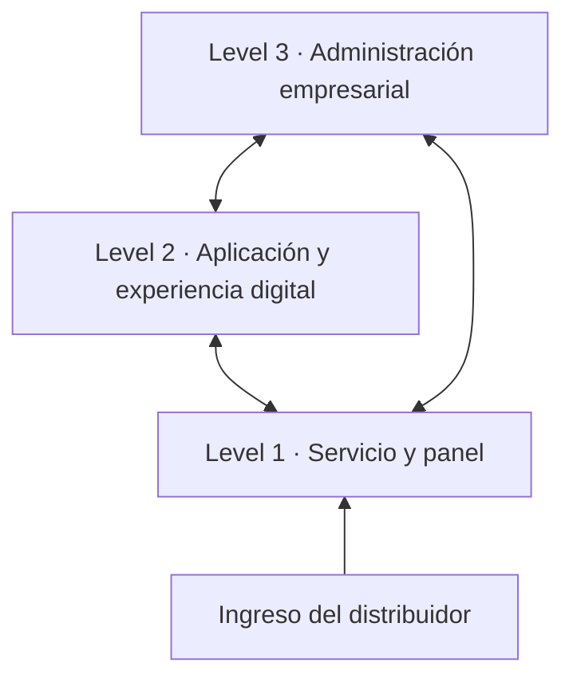

# JUMOCOL OS — Arquitectura comercial de tres niveles

| Campo | Valor |
|---|---|
| Versión | 1.2 |
| Fecha | 2026-11-25 |
| Estado | APROBADO — arquitectura conceptual; lanzamiento condicionado |
| Naturaleza | Documento fundacional de arquitectura comercial |
| Caso de referencia | TiviPlay |
| Repositorio previsto | `jmmode/jumocol-os` |

## 1. Propósito

Definir una arquitectura modular de suministro y distribución de servicios tecnológicos que permita a terceros iniciar, diferenciar, administrar y escalar sus negocios bajo sus propias marcas. HumoCall constituye el entorno empresarial y JUMOCOL OS la arquitectura de integración tecnológica, sin prejuzgar qué sociedad será la contratante de cada oferta; TiviPlay constituye el primer caso de referencia operacional, no una marca obligatoria ni el límite del portafolio.

La arquitectura distingue tres niveles de oferta y una jerarquía comercial independiente. No constituye todavía un plan de compensación, contrato, catálogo aprobado ni autorización de lanzamiento.

HumoCall y TiviPlay son conceptos distintos: TiviPlay es una unidad de negocio y el primer caso de validación, no la totalidad del portafolio empresarial. La independencia de marca se mantiene.

## 2. Principios fundacionales

- Independencia de marca: cada distribuidor puede operar con su propia marca o varias marcas, sujeto a los derechos correspondientes.
- Modularidad: las capacidades se contratan según la necesidad; no se exige comprar una aplicación o un ERP para acceder al servicio.
- Entrada flexible: Level 1 es la entrada básica al negocio de distribución de servicios; se puede contratar una combinación integral desde el inicio.
- Separación funcional: aprovisionamiento técnico, experiencia digital y administración empresarial tienen responsabilidades distintas.
- Independencia de jerarquía: el rol comercial no determina por sí solo las capacidades tecnológicas contratadas.
- Interoperabilidad: integrar soluciones propias y externas mediante interfaces autorizadas, sin asumir compatibilidad universal.
- Gobierno y trazabilidad: permisos, evidencia, aislamiento de datos y responsabilidades deben quedar definidos antes de operar.
- Demanda real: el valor económico procede de servicios y tecnología efectivamente comercializados, no del reclutamiento por sí mismo.

## 3. Arquitectura de referencia

Las conexiones representan integración funcional, no requisitos de ascenso ni dependencia obligatoria de contratación.

| Nivel | Capacidad | Propósito | Entrada / modalidad |
|---|---|---|---|
| Level 1 | Servicio + panel | Comercializar y aprovisionar | Entrada básica |
| Level 2 | APP + AI | Entregar y diferenciar la experiencia digital | Opcional, desde el inicio o posteriormente |
| Level 3 | ERP + CRM + AI | Administrar, sistematizar y escalar | Opcional, desde el inicio o posteriormente |

## 4. Level 1 — Servicio y aprovisionamiento

Es el nivel básico de entrada de un Seller, Reseller o Subreseller. En el caso TiviPlay, el distribuidor adquiere créditos y recibe acceso a un panel con los permisos correspondientes a su rol.

**Alcance funcional:** créditos, saldos, cuentas técnicas, activaciones, renovaciones, vencimientos técnicos y administración de usuarios; gestión de distribuidores subordinados únicamente cuando el rol lo permita. En el caso de contenido audiovisual, el panel suministra acceso a canales, series, películas y demás contenido autorizado.

**Regla de referencia confirmada para el caso actual:** un crédito equivale a un mes de servicio; de una a cinco pantallas no cambia el consumo de créditos. Esta regla no se generaliza automáticamente a otros servicios, proveedores o planes.

**Independencia:** el distribuidor puede utilizar reproductores externos compatibles y sus propios sistemas administrativos. No necesita adquirir Level 2 ni Level 3.

**Límite:** el panel administra el servicio técnico, no sustituye un sistema integral de gestión empresarial. La redistribución y el contenido requieren derechos y autorizaciones verificables.

## 5. Level 2 — Aplicación y experiencia digital

Comprende la interfaz mediante la cual el cliente utiliza el servicio: reproductor, aplicación, identidad visual y capacidades adicionales de inteligencia artificial (AI+), cuando estén definidas y disponibles.

En TiviPlay, la aplicación propia permite acceder a las secciones del servicio, incluidas canales, series, películas y emisoras. Smarters y Net IPTV son ejemplos de reproductores externos, no activos propios de JUMOCOL ni integraciones certificadas por este documento.

**Propuesta de valor:** permitir que un distribuidor entregue una experiencia diferenciada bajo su propia identidad comercial. La personalización y el suministro de aplicaciones de marca propia son capacidades objetivo; su alcance, licenciamiento, mantenimiento, publicación y disponibilidad deberán validarse.

**Independencia:** la aplicación no es el contenido ni el panel. Puede conectarse a servicios compatibles y autorizados, propios o de terceros, según los contratos e interfaces aplicables.

## 6. Level 3 — Administración empresarial

Comprende el sistema de gestión del negocio: ERP (Enterprise Resource Planning), CRM, administración, contabilidad, recursos humanos, gestión comercial y financiera, automatización y agentes de IA. Se utiliza ERP como denominación técnica convencional del sistema denominado ARP durante la conversación.

**Alcance objetivo:** cartera de clientes, ventas, cobros, conciliación, costos, seguimiento de renovaciones, soporte, gestión de equipos, indicadores y trazabilidad. Las capacidades de contabilidad y recursos humanos se consideran parte del alcance conceptual, no módulos terminados o certificados.

**Base tecnológica de referencia:** JUMOCOL OS, intranet, Google Sheets, n8n y agentes como CELIA y MATÍAS, según sus respectivos estados de desarrollo y autorización.

**Independencia:** el ERP/CRM puede integrarse con servicios y aplicaciones de terceros y, potencialmente, atender empresas ajenas al sector audiovisual. No se exige contratar una aplicación propia para incorporar esta capa.

## 7. Contratos de integración entre niveles

| Relación | Información funcional | Límite |
|---|---|---|
| L1 ↔ L2 | Identidad técnica, acceso autorizado, disponibilidad del servicio | No confundir aplicación con derechos de contenido |
| L1 ↔ L3 | Cuenta técnica, créditos, vencimiento, estado de renovación | Pago confirmado no equivale a servicio renovado |
| L2 ↔ L3 | Identidad comercial, soporte y eventos autorizados de experiencia | No compartir datos o credenciales sin permisos |

En el caso TiviPlay, la fecha de próximo pago comercial es independiente del vencimiento técnico. Una cobertura comercial previamente pagada puede autorizar una renovación mensual conforme a las reglas operativas vigentes. La ejecución y la verificación técnica deben conservar evidencia separada.

Los contratos API, esquemas de datos, mecanismos de autenticación y capacidades de escritura quedan pendientes de diseño y validación.

## 8. Independencia de marca y modelo de suministro

JUMOCOL suministra tecnología y capacidades; el distribuidor desarrolla su propia relación comercial con sus clientes según los contratos aplicables. No se obliga al distribuidor a adoptar TiviPlay ni a sustituir su identidad existente.

Un distribuidor podrá operar una o varias marcas. La separación de identidad visual, cartera, permisos, datos y configuración por organización o marca constituye un requisito de diseño; no se afirma que la plataforma multiempresa o multimarca esté implementada.

TiviPlay conserva su identidad como unidad de negocio y caso de validación. El uso de marcas, software y contenidos de terceros queda sujeto a sus respectivas licencias.

## 9. Jerarquía comercial independiente

La jerarquía Master → Seller → Reseller → Subreseller representa relaciones de distribución, no niveles de madurez tecnológica.

| Rol | Level 1 | Level 2 | Level 3 |
|---|---|---|---|
| Master | Potencial | Potencial | Potencial |
| Seller | Potencial | Potencial | Potencial |
| Reseller | Potencial | Potencial | Potencial |
| Subreseller | Potencial | Potencial | Potencial |

Un Subreseller puede contratar las tres capacidades sin convertirse en Seller. La contratación no concede automáticamente permisos jerárquicos ni derechos de redistribución de software. La matriz expresa elegibilidad conceptual, no permisos aprobados.

## 10. Modalidades de adquisición

| Configuración ilustrativa | Servicio | APP propia suministrada | ERP suministrado |
|---|---|---|---|
| Entrada básica | Sí | No | No |
| Servicio con marca digital | Sí | Sí | No |
| Servicio con gestión empresarial | Sí | No | Sí |
| Empresa externa a IPTV | No | Opcional | Sí |
| Operación integral | Sí | Sí | Sí |

Las modalidades no son paquetes tarifarios aprobados. El cliente puede comenzar con una combinación integral o incorporar capacidades posteriormente. La oferta independiente de APP o ERP a empresas con servicios externos es una posibilidad conceptual, pendiente de definición comercial y técnica.

## 11. Relación con JUMOCOL OS y TiviPlay

La arquitectura se alinea con el principio documentado de autonomía operacional: el modelo razona, el documento conserva, el agente ejecuta, el código calcula, la evidencia valida y el humano decide excepciones.

TiviPlay permite validar la convergencia de las tres capas sobre una operación real. Los documentos de noviembre describen un motor financiero parcial, consultas mediante n8n y una integración de intranet pendiente de validación integral. No se deduce de ello que el ERP comercializable, la personalización multimarca o la red multinivel estén listos para producción.

## 12. Rangos comerciales — escala aprobada

Se mide la cartera propia de clientes finales activos verificables, sin contar pantallas, créditos comprados sin utilizar ni personas reclutadas. La definición de actividad, ventana de medición, atribución y deduplicación quedan pendientes.

| Rango | Clientes activos | Umbral de entrada |
|---|---:|---:|
| Partner inicial | 0–49 | 0 |
| Bronze | 50–149 | 50 |
| Silver | 150–499 | 150 |
| Gold | 500–999 | 500 |
| Platinum | 1.000–2.499 | 1.000 |
| Diamond | 2.500–4.999 | 2.500 |
| Diamond Elite | 5.000 o más | 5.000 |

Los rangos no equivalen a roles, compras obligatorias, permisos, remuneraciones ni promesas de ingresos. Para otros productos B2B se definirán métricas específicas: no se mezclan clientes empresariales y usuarios de IPTV sin una regla aprobada.

## 13. Evolución comercial y multisectorial

- Fase actual: optimizar y escalar el servicio y la distribución de créditos Level 1 que dirección identifica como funcionales. Validar por separado disponibilidad de paneles, permisos y derechos de redistribución; no afirmar que la red multinivel está desplegada.
- Fase siguiente: ampliar Level 3 a otras empresas mediante ERP, CRM y automatización, reutilizando procesos validados en TiviPlay. Cada módulo requiere aceptación técnica y comercial.
- Level 2 transversal: aplicaciones y herramientas digitales que complementan la gestión empresarial, no limitadas a reproductores audiovisuales. Pueden integrarse con Level 3 y servicios externos. Una empresa ajena a IPTV puede contratar Level 3 y añadir Level 2 sin adquirir Level 1 de IPTV.
- Principio de expansión: optimizar, validar, repetir, automatizar y escalar. El crecimiento exponencial es una aspiración, no una garantía ni previsión.

## 14. Validación jurídica preliminar — Colombia

**Estado: revisión normativa documental; no constituye concepto jurídico ni autorización de lanzamiento.**

El artículo 2 de la Ley 1700 de 2013 exige analizar conjuntamente incorporación de personas naturales en cadena, remuneración o descuentos derivados de ventas por la red y coordinación comercial. La denominación reseller o B2B no excluye por sí sola la aplicación de la ley. Debe verificarse la realidad contractual y económica de cada canal.

| Tema | Referencia | Control previo al lanzamiento |
|---|---|---|
| Clasificación y sociedad responsable | Ley 1700 art. 2; Decreto 1074 art. 2.2.2.50.3 | Identificar entidad contratante, estructura colombiana o sucursal cuando corresponda y oficina permanente abierta al público. |
| Remuneración | Decreto 1074 art. 2.2.2.50.1 | No remunerar incorporación por sí sola; vincular compensación a ventas reales verificables. |
| Rangos y compensación | Ley 1700 art. 6; Decreto 1074 art. 2.2.2.50.2 | Documentar reglas, beneficios y requisitos; informar antes de contratar y mantener disponibilidad en oficina y web cuando exista. |
| Contrato | Ley 1700 arts. 9–10 | Contrato escrito con contenido mínimo; evitar permanencia, exclusividad, cláusulas abusivas e inventario superior al previamente pactado. |
| Créditos | Ley 1700 art. 6 par. 1 | Diferenciar créditos adquiridos para prestar servicio y recompensas en puntos o reconsumo; estas últimas tienen límite legal del 50% y derecho de rechazo. |
| Productos y derechos | Ley 1700 art. 11 | Revisar prohibiciones por producto y derechos de distribución audiovisual, software y marcas; no inferir autorización por ausencia de prohibición expresa. |
| Supervisión | Circular Básica Jurídica, cap. IX | Verificar obligaciones de vigilancia, información y reportes ante Supersociedades. |
| Publicidad y datos | Revisión complementaria pendiente | Validar protección al consumidor, publicidad verificable, tratamiento de datos y contratos internacionales. No prometer ganancias garantizadas. |

Fuentes oficiales consultadas el 25/11/2026:
- [Ley 1700 de 2013 — Función Pública](https://www.funcionpublica.gov.co/eva/gestornormativo/norma.php?i=56283).
- [Decreto 1074 de 2015 — Cancillería, capítulo de multinivel incorporado por Decreto 24 de 2016](https://cancilleria.gov.co/sites/default/files/Normograma/docs/decreto_1074_2015_pr037.htm).
- [Superintendencia de Sociedades — Circular Básica Jurídica, capítulo IX](https://supersociedades.gov.co/web/nuestra-entidad/cap-9-regimenes-especiales).

Gate: antes de captar distribuidores bajo el nuevo plan, publicar publicidad de oportunidad comercial o ejecutar un piloto multinivel externo, obtener revisión de abogado colombiano del modelo real, derechos de suministro, entidad responsable, contratos, plan de compensación y obligaciones regulatorias. No se suspende por este documento la operación ordinaria existente; tampoco se certifica su cumplimiento.

## 15. Alcance excluido y decisiones pendientes

- Precios, paquetes, licencias y comisiones de cada nivel.
- Reglas de ascenso y descenso, plan de compensación y permisos definitivos de la red.
- Costos operativos, soporte, SLA, responsabilidades y garantías.
- Derechos de distribución de contenido y software; revisión jurídica del modelo multinivel y de protección de datos.
- Arquitectura técnica multiempresa/multimarca, integraciones y pruebas de aceptación.
- Nombre comercial definitivo de la oferta tecnológica y política de marca.

La auditoría multinivel V2.0 anterior se conserva como antecedente de Level 1; sus cifras y recomendaciones no se aprueban ni se extienden a los otros niveles mediante este documento.

## 16. Criterios de aprobación documental

- Orden confirmado: servicio, aplicación, administración empresarial.
- Level 1 identificado como entrada básica, sin compras obligatorias adicionales.
- Posibilidad de contratación simultánea o progresiva.
- Independencia de marcas y separación entre jerarquía comercial y capacidades.
- TiviPlay identificado como caso de referencia, no como marca obligatoria.
- Distinción explícita entre capacidades actuales, objetivos y pendientes.

## 17. Fuentes de continuidad

- Conversación de arquitectura comercial del 25/11/2026 y esquema manuscrito explicado por dirección; la corrección posterior de numeración prevalece.
- [Contexto estratégico Q4 2026](https://github.com/jmmode/jumocol-os/blob/main/01_CONTEXT/JUMOCOL_OS_AUTONOMIA_OPERACIONAL_Q4_2026_AVANCE_2026-09-30.md).
- [Mapa operativo n8n e intranet diciembre 2026](https://github.com/jmmode/jumocol-os/blob/main/02_RUNTIME/tiviplay/MAPA_OPERATIVO_N8N_E_INTRANET_DICIEMBRE_2026.md).
- [Contrato del motor financiero](https://github.com/jmmode/jumocol-os/blob/main/02_RUNTIME/tiviplay/MOTOR_FINANCIERO_N8N_CONTRATO_HARRY_PILOTO_MARCO_2026-11-21.md).

## 18. Checkpoint y siguiente acción

**Aprobado por dirección:** arquitectura conceptual de tres niveles, independencia comercial y tecnológica, expansión multisectorial y escala de rangos V1.2. Ruta confirmada: `01_CONTEXT/JUMOCOL_OS_ARQUITECTURA_COMERCIAL_TRES_NIVELES_V1_2.md`.

**Pendiente:** validación jurídica integral y demás decisiones de la sección 15. La aprobación documental no autoriza el lanzamiento multinivel.

**Siguiente acción:** registrar esta versión en GitHub. El trabajo normativo queda como frente posterior obligatorio antes del lanzamiento.