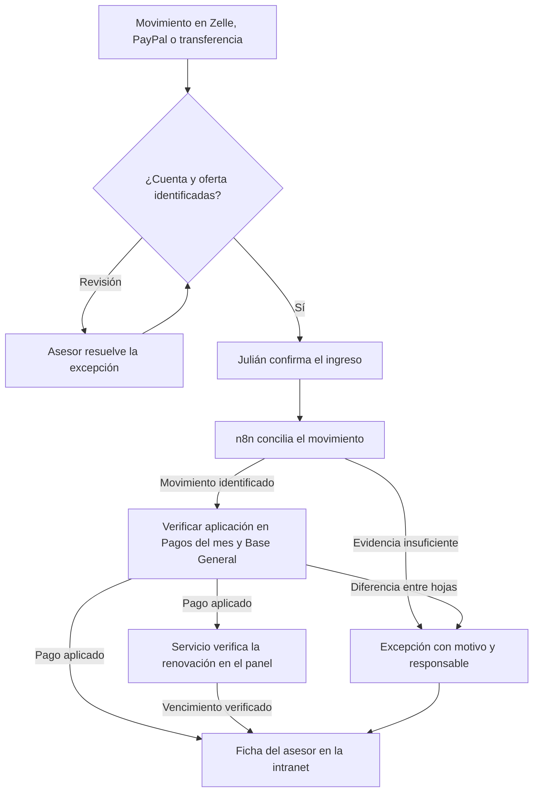

# TiviPlay · Mapa operativo de n8n y la intranet para diciembre de 2026

**Corte documental del 21 de noviembre de 2026.** Meta propuesta de validación con un asesor el sábado 28 de noviembre, para operar desde el 1 de diciembre. La ruta y las fechas son objetivos de trabajo. El motor financiero está **PARCIAL** y la validación de punta a punta está pendiente.

## Qué debe poder resolver el asesor

Al abrir la intranet y seleccionar la cuenta correcta, el asesor puede saber si el pago fue confirmado, cuándo corresponde el próximo cobro y hasta qué fecha está vigente el servicio en el panel. Si el dinero ya se recibió y falta aplicar o verificar la renovación, la ficha muestra **Pago confirmado · Renovación pendiente**, el motivo y quién debe continuar. El asesor puede atender al cliente desde esa ficha.

## Cómo recorre el sistema un pago

- **Identidad y confirmación.** El movimiento se vincula con su referencia estable, la cuenta beneficiaria y el período. Las filas de Sheets sirven para localizar los datos. El asesor aclara discrepancias de oferta, promoción o número de pantallas. Julián conserva la confirmación financiera `CONFIRMADO JM`.
- **Aplicación financiera.** Con la primera escritura autorizada, el motor registra el pago en la hoja mensual, actualiza lo que corresponde en Base General y relee ambos destinos. Conserva la fecha real del ingreso y calcula el próximo cobro desde el vencimiento contractual anterior. Ante una repetición, comprueba qué se aplicó. Si encuentra un desfase, identifica la actualización que falta o lo deja en revisión.
- **Servicio.** El equipo localiza la cuenta técnica por su usuario y panel. El vencimiento técnico `F.VENCIMIENTO` requiere evidencia del panel o del control operativo que registra la renovación. El acceso a las credenciales queda en el canal técnico autorizado. La ficha reúne el resultado financiero y el técnico con su estado de verificación.

## Punto de partida

| Evidencia al 21 de noviembre | Qué permite retomar |
|---|---|
| Harry · recorrido manual documentado | Sirve como referencia de validación comercial, confirmación financiera y aplicación en la hoja mensual y la maestra. |
| Marco · piloto de PayPal | La regla financiera recoge las ejecuciones 40 y 41 en modo de prueba. Base General ya mostraba diciembre. Falta acreditar si ese mismo evento produjo la actualización en ambos destinos. |
| Consulta de clientes | La bitácora de CELIA registra una prueba de consulta mediante n8n. Es una pieza reutilizable para la lectura. La ficha integrada de pagos y servicio sigue pendiente de validación con un asesor. |

## Cuatro chats de Work, un mismo mapa

| Chat | Encargo | Entrega al siguiente frente |
|---|---|---|
| Coordinación · este mapa | ChatGPT prepara una tarea por cambio, compara la evidencia con los contratos y conserva las decisiones. Julián resuelve excepciones de negocio y autoriza el paso a escrituras reales. | Estado probado, decisión pendiente y siguiente tarea. |
| Pagos · agente de n8n | Retomar `TIVIPLAY_MOTOR_PAGOS_V1_DRY_RUN` y el nodo `CONCILIACION_FINANCIERA`. | Cuenta, período, resultado por destino, próximo cobro y motivo de cualquier excepción. |
| Servicio · equipo operativo y plataforma | Vincular cuenta, usuario y panel. Confirmar el vencimiento con la evidencia técnica disponible. | Estado de renovación, vencimiento verificado y pendiente de gestión si aplica. |
| Intranet · plataforma y asesor | Preparar la ficha con los campos que entregan Pagos y Servicio. El asesor contrasta lo que ve con un caso real. | Una consulta con pago, próximo cobro, estado del servicio y acción pendiente. |

Los frentes de Servicio e Intranet pueden preparar sus campos y sus vistas en paralelo al piloto financiero. La prueba conjunta necesita la salida verificada de cada frente.

## Ventanas y pruebas de cierre

| Fecha objetivo · Bogotá | Tarea | Evidencia para cerrar |
|---|---|---|
| 22 de noviembre | Conciliar el mismo evento del piloto de Marco dos veces, en solo lectura. | Ambas ejecuciones producen el mismo resultado financiero. La evidencia indica dónde se aplicó el evento o qué falta para decidirlo. |
| 23–24 de noviembre | Probar la primera escritura autorizada con un movimiento inequívoco. | Lectura posterior de ambas hojas y reintento que conserva el registro y el próximo cobro. Una aplicación parcial conserva el motivo y el destino pendiente. |
| 25–26 de noviembre | Conectar la consulta de cuenta y panel con la ficha del asesor. | La ficha distingue el próximo cobro del vencimiento técnico y muestra una renovación pendiente cuando falta la confirmación del panel. |
| 27–28 de noviembre | Probar una renovación de punta a punta con un asesor y ensayar el cambio de hoja mensual. | El asesor puede explicar el estado con la ficha. La renovación que cruza a diciembre concuerda con las fuentes y el flujo selecciona la hoja de diciembre al cambiar de período. |

## Primera tarea al retomar desde el computador

> En el flujo existente de n8n, retoma las ejecuciones 40 y 41 y revisa el pago de Marco en `CONCILIACION_FINANCIERA`. Mantén el modo de solo lectura. Comprueba por evento, cuenta y período si el mismo movimiento se aplicó en Pagos Noviembre y en Base General. Repite la consulta y devuelve los dos identificadores de ejecución, el resultado por hoja y la evidencia que sustenta la conclusión. Si solo consta una fecha de diciembre, indica qué falta para acreditar la aplicación. Comparte una salida depurada.

El chat de Coordinación compara los resultados con la regla de ciclo. Si falta evidencia, el caso queda en revisión con la causa exacta. La primera prueba de escritura se reserva para un movimiento inequívoco y la autorización de Julián.

## Fuentes de continuidad

Base documental consultada en `jmmode/jumocol-os`, rama `main`, commit `492faa6`. Esta edición documenta la conversación y la ruta propuesta.

- [Contrato del motor financiero y pilotos de referencia](./MOTOR_FINANCIERO_N8N_CONTRATO_HARRY_PILOTO_MARCO_2026-11-21.md)
- [Regla financiera para pagos anticipados y evidencia de las ejecuciones 40 y 41](./REGLA_FINANCIERA_FECHA_CICLO_PAGO_ANTICIPADO_V1_2026-11-21.md)
- [Transferencia operacional y alcance de la consulta de clientes](./celia/CELIA_TRANSFERENCIA_OPERACIONAL_Y_WORK_ORDER_N8N_2026-11-21.md)
