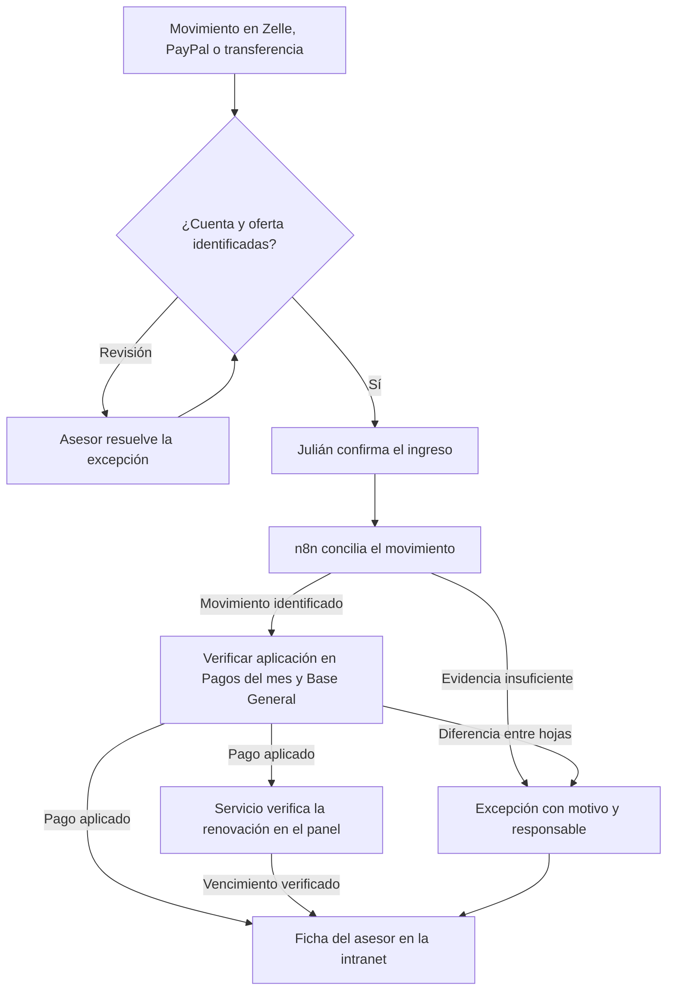

# TiviPlay · Mapa operativo de n8n y la intranet para diciembre de 2026

**Corte documental del 21 de noviembre de 2026.** Meta propuesta de validación con un asesor el sábado 28 de noviembre, para operar desde el 1 de diciembre. La ruta y las fechas son objetivos de trabajo. El motor financiero está **PARCIAL** y la validación de punta a punta está pendiente.

## Qué debe poder resolver el asesor

Al abrir la intranet y seleccionar la cuenta correcta, el asesor puede saber si el pago fue confirmado, cuándo corresponde el próximo cobro y hasta qué fecha está vigente el servicio en el panel. Si el dinero ya se recibió y falta aplicar o verificar la renovación, la ficha muestra **Pago confirmado · Renovación pendiente**, el motivo y quién debe continuar. El asesor puede atender al cliente desde esa ficha.

## Cómo recorre el sistema un pago

- **Identidad y confirmación.** El movimiento se vincula con su referencia estable, la cuenta beneficiaria y el período. Las filas de Sheets sirven para localizar los datos. El asesor aclara discrepancias de oferta, promoción o número de pantallas. Julián conserva la confirmación financiera `CONFIRMADO JM`.
- **Aplicación financiera.** Con la primera escritura autorizada, el motor registra el pago en la hoja mensual, actualiza lo que corresponde en Base General y relee ambos destinos. Conserva la fecha real del ingreso y calcula el próximo cobro desde el vencimiento contractual anterior. Ante una repetición, comprueba qué se aplicó. Si encuentra un desfase, identifica la actualización que falta o lo deja en revisión.
- **Servicio.** El equipo localiza la cuenta técnica por su usuario y panel. El vencimiento técnico `F.VENCIMIENTO` requiere evidencia del panel o del control operativo que registra la renovación. El acceso a las credenciales queda en el canal técnico autorizado. La ficha reúne el resultado financiero y el técnico con su estado de verificación.

## Punto de partida

| Evidencia al 21 de noviembre | Qué permite retomar |
|---|---|
| Harry · recorrido manual documentado | Sirve como referencia de validación comercial, confirmación financiera y aplicación en la hoja mensual y la maestra. |
| Marco · piloto de PayPal | La regla financiera recoge las ejecuciones 40 y 41 en modo de prueba. Base General ya mostraba diciembre. Falta acreditar si ese mismo evento produjo la actualización en ambos destinos. |
| Consulta de clientes | La bitácora de CELIA registra una prueba de consulta mediante n8n. Es una pieza reutilizable para la lectura. La ficha integrada de pagos y servicio sigue pendiente de validación con un asesor. |

## Cuatro chats de Work, un mismo mapa

| Chat | Encargo | Entrega al siguiente frente |
|---|---|---|
| Coordinación · este mapa | ChatGPT prepara una tarea por cambio, compara la evidencia con los contratos y conserva las decisiones. Julián resuelve excepciones de negocio y autoriza el paso a escrituras reales. | Estado probado, decisión pendiente y siguiente tarea. |
| Pagos · agente de n8n | Retomar `TIVIPLAY_MOTOR_PAGOS_V1_DRY_RUN` y el nodo `CONCILIACION_FINANCIERA`. | Cuenta, período, resultado por destino, próximo cobro y motivo de cualquier excepción. |
| Servicio · equipo operativo y plataforma | Vincular cuenta, usuario y panel. Confirmar el vencimiento con la evidencia técnica disponible. | Estado de renovación, vencimiento verificado y pendiente de gestión si aplica. |
| Intranet · plataforma y asesor | Preparar la ficha con los campos que entregan Pagos y Servicio. El asesor contrasta lo que ve con un caso real. | Una consulta con pago, próximo cobro, estado del servicio y acción pendiente. |

Los frentes de Servicio e Intranet pueden preparar sus campos y sus vistas en paralelo al piloto financiero. La prueba conjunta necesita la salida verificada de cada frente.

## Ventanas y pruebas de cierre

| Fecha objetivo · Bogotá | Tarea | Evidencia para cerrar |
|---|---|---|
| 22 de noviembre | Conciliar el mismo evento del piloto de Marco dos veces, en solo lectura. | Ambas ejecuciones producen el mismo resultado financiero. La evidencia indica dónde se aplicó el evento o qué falta para decidirlo. |
| 23–24 de noviembre | Probar la primera escritura autorizada con un movimiento inequívoco. | Lectura posterior de ambas hojas y reintento que conserva el registro y el próximo cobro. Una aplicación parcial conserva el motivo y el destino pendiente. |
| 25–26 de noviembre | Conectar la consulta de cuenta y panel con la ficha del asesor. | La ficha distingue el próximo cobro del vencimiento técnico y muestra una renovación pendiente cuando falta la confirmación del panel. |
| 27–28 de noviembre | Probar una renovación de punta a punta con un asesor y ensayar el cambio de hoja mensual. | El asesor puede explicar el estado con la ficha. La renovación que cruza a diciembre concuerda con las fuentes y el flujo selecciona la hoja de diciembre al cambiar de período. |

## Primera tarea al retomar desde el computador

> En el flujo existente de n8n, retoma las ejecuciones 40 y 41 y revisa el pago de Marco en `CONCILIACION_FINANCIERA`. Mantén el modo de solo lectura. Comprueba por evento, cuenta y período si el mismo movimiento se aplicó en Pagos Noviembre y en Base General. Repite la consulta y devuelve los dos identificadores de ejecución, el resultado por hoja y la evidencia que sustenta la conclusión. Si solo consta una fecha de diciembre, indica qué falta para acreditar la aplicación. Comparte una salida depurada.

El chat de Coordinación compara los resultados con la regla de ciclo. Si falta evidencia, el caso queda en revisión con la causa exacta. La primera prueba de escritura se reserva para un movimiento inequívoco y la autorización de Julián.

## Fuentes de continuidad

Base documental consultada en `jmmode/jumocol-os`, rama `main`, commit `492faa6`. Esta edición documenta la conversación y la ruta propuesta.

- [Contrato del motor financiero y pilotos de referencia](./MOTOR_FINANCIERO_N8N_CONTRATO_HARRY_PILOTO_MARCO_2026-11-21.md)
- [Regla financiera para pagos anticipados y evidencia de las ejecuciones 40 y 41](./REGLA_FINANCIERA_FECHA_CICLO_PAGO_ANTICIPADO_V1_2026-11-21.md)
- [Transferencia operacional y alcance de la consulta de clientes](./celia/CELIA_TRANSFERENCIA_OPERACIONAL_Y_WORK_ORDER_N8N_2026-11-21.md)

---

## Actualización operacional · 21–22 de noviembre de 2026 · Crédito técnico diario e intranet

**Jerarquía documental:** esta actualización precisa y acelera las ventanas propuestas antes en este mapa; no sustituye el contrato vigente **S0 v0.3 del 21/10/2026, sección 7.1**. Las fechas 22–30/11 son objetivos de ejecución, no evidencia de despliegue. No confundir diseño, implementación y validación.

### Decisión operativa D-SRV-001 — Cobertura ya pagada permite crédito mensual

El asesor NO debe abrir BASE GENERAL para comprobar manualmente `F. PRÓXIMO PAGO` cada vez que otorga un crédito. La intranet debe mostrar la autorización técnica calculada, el panel y la tarea concreta. El motor consulta **BASE GENERAL** y **CONTROL** de panel. Una renovación técnica mensual puede ser necesaria aunque no haya un nuevo pago en el mes, por ejemplo cuando el cliente pagó 6 o 12 meses por adelantado.

**Regla aprobada y ya documentada:** sección 7.1 «Caso B — Cobertura vigente ya pagada» del contrato operativo v0.3:
- `TC=1`; identidad de cuenta técnica inequívoca; `F. PRÓXIMO PAGO` de BASE GENERAL posterior a la fecha efectiva del crédito; y cobertura compatible con `PLAN ACTIVO`, incluidos beneficios `+k` expresos y autorizados.
- `F.VENCIMIENTO` técnico genera **necesidad** de renovación; no autoriza crédito por sí mismo.
- Caso A: pago nuevo con `CONFIRMADO JM`, enlace y oferta inequívocos.
- Caso B: cobertura comercial vigente previamente pagada. **No requerir otro `CONFIRMADO JM` mensual en este caso**.
- Excepciones con bonificaciones, acuerdos o extensiones necesitan evidencia comercial autorizada; no deducir períodos adicionales.
- `PAGO VALIDADO ≠ SERVICIO RENOVADO`; `CRÉDITO EJECUTADO ≠ BASE ACTUALIZADA`.
- Crédito solo se considera ejecutado con evidencia en CONTROL y, para verificación técnica definitiva, constancia del panel o control operacional autorizado; la fecha nueva se repliega a `F.VENCIMIENTO` de BASE GENERAL con verificación y trazabilidad.
- Crear tarea normalmente en `F.VENCIMIENTO - 1` (con alertas vencidas), y no generar créditos repetidos para una misma cuenta/período por reintentos.

### Fuentes reales identificadas (metadata y encabezados vivos, 21–22/11)

**Spreadsheet:** `GESTION_DIA_PAGOS_2026_TIVIPLAY` (ID `1bOgUMrHoAyAm-aoRhXgylWfbHph7tsvJYz1mIujdi-4`).

| Fuente | Campos observados de la primera fila de encabezados | Particularidad |
|---|---|---|
| `BASE GENERAL` | `TC`, `ESTADO`, `PLAN ACTIVO`, `USUARIO`, `PANEL`, `F.VENCIMIENTO`, `F.ULTIMO PAGO`, `F. PRÓXIMO PAGO` | Cobertura y estado financiero maestro |
| `CONTROL (NOV) P1` | `TC`, `ASESOR`, `RECARGA`, `ID`, `USUARIO`, `CONTRASEÑA`, `PANEL`, `FECHA`, `F.VENCIMIENTO`, `ORIGEN`, `CREDITO` | Registro técnico de P1 |
| `CONTROL (NOV) P2` | mismos campos de encabezado que P1 | Pueden existir fechas incoherentes: verificar semántica antes de repliegue |
| `CONTROL (NOV) P3` | idem; contiene dos encabezados `ORIGEN` repetidos | No fijar posiciones por nombre duplicado sin mapear índice |
  
Los nombres exactos de pestañas son **`CONTROL (NOV) P1`**, **`CONTROL (NOV) P2`**, **`CONTROL (NOV) P3`**, no `CONTROL NOVIEMBRE PANEL 1` etc. `CONTRASEÑA` está en CONTROL y BASE, pero nunca debe incluirse en salida general de intranet, logs ni repositorio público. No almacenar PII de clientes aquí.

### Contrato de salida a intranet (propuesto para implementación)

Identificar por cuenta técnica estable + panel; no usar número de fila como clave permanente. Una ficha de cuenta y una **cola diaria de tareas por panel** deben exponer:

- `service_account_id`, `panel_id` P1/P2/P3, nombre de cliente para el asesor autenticado, `financial_status` (cobertura vigente, vencida o revisión), `financial_next_due_at`, `technical_expires_at`, `technical_verified_at` (si hay evidencia).
- `credit_eligibility`: `HABILITADO_PAGO_NUEVO`, `HABILITADO_COBERTURA_VIGENTE`, `REQUIERE_REVISION` o `NO_HABILITADO` con motivo, **sin extrapolar estado desde la sola fecha técnica**.
- `task_type=OTORGAR_CREDITO`, `due_at`, `assigned_to`, `task_state` PENDIENTE/EN_PROCESO/EJECUTADO/VERIFICADO/EXCEPCIÓN, `credit_period`, `control_source`, `evidence_ref`.
- `finance_sync_state` y `service_sync_state` separados: un pago confirmado con renovación técnica pendiente genera tarea sin detener la conciliación financiera.
- No mostrar secreto técnico en ficha genérica. Operadores con permisos adecuados usan ruta autorizada al panel. Auditar accesos y cambios.

### Definición de DoD de tarea técnica

`identidad y panel inequívocos + cobertura válida (caso A/B o excepción aprobada) + crédito de período no duplicado + ejecución por operador + evidencia de CONTROL + verificación de panel/resultado + F.VENCIMIENTO reconciliada en BASE GENERAL + ficha intranet actualizada`.

La **preparación y visualización de una tarea** puede estar validada antes de automatizar la concesión de créditos. No se implementa concesión automática a los paneles sin interfaz autorizada, capacidades verificadas y controles de no duplicidad.

### Checklist por entregas y fechas (Bogotá)

| Gate | Plazo objetivo | Owner | Acción implementable | Evidencia/DoD |
|---|---|---|---|---|
| G0 Fuentes y contrato | 21–22/11 | Coordinación + Plataforma | Mapear encabezados, claves, diferencias P1/P2/P3; asegurar accesos, roles y regla S0-E 7.1 | Tabla de campos reales, duplicados, fechas ambiguas identificadas |
| G1 Finanzas operativa | 22–23/11 | n8n + Finanzas | RF-CICLO-001, ledger idempotente, trigger conectado, actualización segura PAGOS MES y BASE GENERAL | Lectura fresca, escritura autorizada + readback y replay sin doble aplicación |
| G2 Servicio elegibilidad | 22–23/11 | Plataforma + Operación | Implementar cálculo diario Caso A/B por cuenta: cruce BASE GENERAL↔CONTROL panel, cola OTORGAR_CREDITO por panel, sin contraseñas en respuestas | Muestra de cuentas con pago mensual y anual + casos excluidos; sin créditos duplicados |
| G3 Intranet MVP | 23/11 | Plataforma + Operación | Vista de cliente, dos estados, crédito habilitado, panel, próxima tarea y cola filtrable por P1/P2/P3 | Asesor autenticado consulta cuentas reales sin abrir Sheets; datos contrastados |
| G4 Ejecución/verificación servicio | 23–25/11 | Operación + Plataforma | Operador registra crédito y evidencia; verificadores actualizan control y BASE, detectan desfases | Una renovación real por panel (cuando autorizada) y resultado de relectura; sin concesión duplicada |
| G5 Prueba semanal | 24–28/11 | Asesores + Gobierno | Ensayos diarios de casos anual, mensual, bonificación, vencido, panel erróneo y reintentos | Evidencias por caso, métricas, pendientes y owners; gate sólo con criterios satisfechos |
| G6 Preparación y lanzamiento | 29/11 | Gobierno + Operación | Correcciones, backup, checklist de permisos/seguridad, operación asistida | Go/no-go auditable, rollback y responsables |
| G7 Cierre mensual diciembre | 30/11 | Motor mensual + Back Office | Ejecutar el motor existente `05_AUTOMATION/tiviplay-monthly-close-v1` con BASE consolidada, generar/validar/publicar `PAGOS DICIEMBRE 2026` | Snapshot, universo, exclusiones, duplicados, preview y nueva hoja confirmada por readback |

**Restricción importante:** el motor mensual existente genera preview y evidencia en solo lectura; no publica automáticamente la hoja del mes. El paso de publicación requiere implementación y verificación de escritura aparte. El 30/11 es día de ejecutar un cierre ya ensayado, no de programar esta capacidad por primera vez.

**Gates:** no declarar `IMPLEMENTADO` por el mero hecho de crear un nodo o documento; `VALIDADO` exige evidencia de ejecución real. Si falla el gate anterior, registrar brecha/decisión explícita para continuar acotadamente; no inventar sincronización.

### ACTIVE CONTEXT / CHECKPOINT / NEXT ACTION

**ACTIVE CONTEXT:** la regla de elegibilidad de crédito (A/B) ya existe en S0 v0.3. La nueva capacidad pendiente es su aplicación automática en tareas diarias y ficha intranet.  
**DECISION LOG:** D-SRV-001 = cobertura anual/multimes pagada autoriza sucesivas renovaciones técnicas mensuales cuando cumple contrato; sin cobro nuevo ni aprobación JM mensual.  
**EVIDENCIA:** lectura del contrato vigente v0.3; metadata viva y encabezados de BASE GENERAL + CONTROL (NOV) P1/P2/P3; ninguna escritura ni concesión técnica probada en esta revisión.  
**BACKLOG P0:** G1 ledger y escrituras, G2 regla elegibilidad, G3 cola de tareas/ficha, G7 publicación mensual.  
**NEXT ACTION exacta:** completar mapeo técnico de los controles P1/P2/P3 y, en paralelo con G1 n8n, encargar a Plataforma un único MVP de consulta de elegibilidad + cola diaria visible en intranet, reutilizando módulos existentes.
