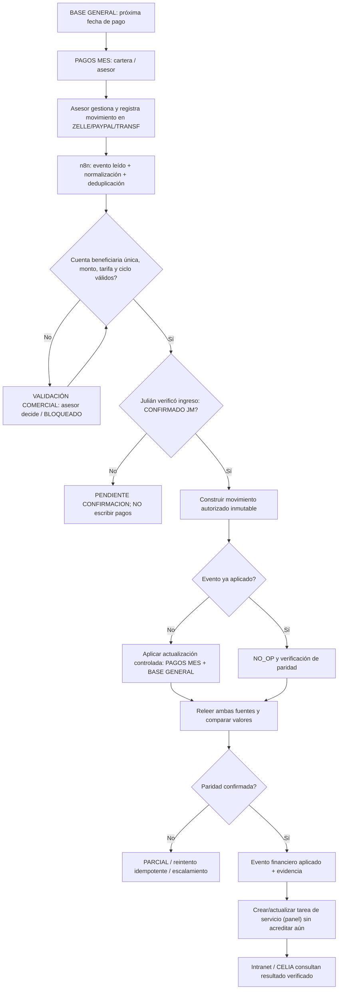

# TIVIPLAY — MOTOR FINANCIERO n8n · Contrato de ciclo Harry / piloto Marco
**Versión:** 1.0 · **Fecha:** 2026-11-21 · **Estado:** DOCUMENTADO · n8n motor financiero NO IMPLEMENTADO / REQUIERE DECISIÓN para escrituras  
**Repositorio:** `jmmode/jumocol-os` (main) · **área:** 04 Plataforma y Equipo, dependencias 02 Finanzas/Servicio, 01 Atención/Cobranza, 00 Gobierno  
**Objetivo único:** trasladar la secuencia del caso Harry desde las fórmulas distribuidas en Sheets a una orquestación n8n, comprobarla con un **segundo caso real** (Marco Campos/Javier, PAYPAL), sin duplicar pagos ni basarse en números de fila.  
**Fuente viva:** `GESTION_DIA_PAGOS_2026_TIVIPLAY` (Google Sheets ID `1bOgUMrHoAyAm-aoRhXgylWfbHph7tsvJYz1mIujdi-4`).

## 1 · Contrato de proceso que YA existe (no rehacer el inventario)



**Propiedad clave:** el asesor no emite `CONFIRMADO JM`; confirma Julián. Estado financiero `F. PRÓXIMO PAGO` no equivale al vencimiento técnico `F.VENCIMIENTO`. Ninguna fecha técnica se modifica al procesar el pago.

## 2 · Harry, oráculo de negocio histórico

| Paso | Fuente / resultado aprobado de referencia |
|---|---|
| Entrada a ciclo | `BASE GENERAL`, gobernada por próxima fecha de pago |
| Gestión | `PAGOS NOVIEMBRE 2026`, asesor |
| Movimiento | `ZELLE (NOV)`, id lógico documental `ZELLE-NOV-14` |
| Confirmación financiera | `CONFIRMADO JM` |
| Validación de oferta | tarifa `TVP26_010`, USD 150, 12 meses + 3 bonificados, 3 pantallas TV y 1 celular, validación comercial autorizada |
| Salida esperada histórica | último pago 2026-11-04; próximo pago 2028-02-04 |
| Acreditación técnica | proceso SEPARADO, con evidencia de panel |

**ALERTA CRÍTICA DETECTADA 2026-11-21:** tras eliminación de filas en BASE GENERAL, el movimiento ZELLE de Harry en la hoja viva refiere `K14=770`, y `BASE GENERAL!B770` corresponde a Harry; sin embargo `PAGOS NOVIEMBRE!X5` conserva `BASE GENERAL!771`, que corresponde hoy a otro cliente. En lectura posterior, `BASE GENERAL!R770=02-11-25` y `S770=02-11-26`, mientras el contrato histórico aprobó fechas nuevas. **Por tanto Harry es oráculo de reglas y evidencia histórica, NO prueba vigente de paridad ni candidato a escritura ciega.** Registrar brecha y no copiar datos `!771`.

## 3 · Segundo caso seleccionado: Marco Campos/Javier (PAYPAL)

**Objetivo de la prueba:** ejecutar en n8n sobre un caso real de **otra fuente**, con `CONFIRMADO JM` y resultado ya reflejado en maestro. El resultado correcto de la primera prueba es `ALREADY_APPLIED / NO_OP`, no una nueva actualización ni extensión del ciclo.

| Campo | Evidencia viva 2026-11-21 |
|---|---|
| Movimiento PAYPAL | `PAYPAL (NOV)!4` |
| Confirmación | `M4=CONFIRMADO JM` |
| Beneficiario | Marco Campos/Javier |
| Cuenta técnica | `BASE GENERAL!N780=LP1000290` (identificador de servicio; fila actual circunstancial) |
| Enlace reportado en PAYPAL | `P4=780` |
| Importe neto aplicable | `PAYPAL!W4=15 USD` (no confundir con total factura y comisión PayPal) |
| Validación fuente | `Y4=COINCIDE PLAN`, `AD4=VALIDADO`, `AI4=VALIDADO` |
| Último pago esperado | `2026-11-05` |
| Próximo pago esperado | `2026-12-05` |
| Maestro 2026-11-21 | `BASE GENERAL!R780=05-11-26` y `S780=05-12-26` |
| Referencia mensual desfasada | `PAGOS NOVIEMBRE!X25=BASE GENERAL!781` (actualmente otra persona); `W25` sin `CONFIRMADO JM` en última lectura |

**Acción de n8n propuesta:** localizar `LP1000290` en BASE GENERAL por columna `N`, verificar nombre/ID/método, localizar mensual por `M=LP1000290`, relacionar `PAYPAL!4` y evaluar estado. **No escribir en esta primera prueba**. Tras una segunda validación de paridad, la actualización controlada de fila mensual puede autorizarse con valores del evento, nunca por `X25` legado.

**Importante:** después de borrados de fila, el número `BASE GENERAL!780` puede volver a cambiar; la clave de servicio también deberá comprobar unicidad. Es una clave candidata heredada, no un `UUID` universal demostrado. Para modelo definitivo: `service_account_id` estable e inmutable.

## 4 · Contrato de entrada y salida de la operación n8n

### Evento normalizado (estructura; sin datos personales en producción de GitHub)
```json
{
  "source": "PAYPAL (NOV)",
  "source_event_id": "<id_financiero_persistente_verificado>",
  "service_account_key": "<identificador_servicio_único>",
  "payer_reference": "<referencia_privada>",
  "amount": 15,
  "currency": "USD",
  "paid_at": "2026-11-05",
  "financial_status": "CONFIRMADO JM",
  "commercial_status": "VALIDADO",
  "plan_code": "<codigo_de_tarifa_aprobado>",
  "effective_months": 1,
  "run_mode": "DRY_RUN"
}
```

No considerar `PAYPAL-NOV-4` o una fila física como identificador global inmutable: cuando se inserten/eliminen filas cambia. Resolver un `source_event_id` basado en una referencia financiera realmente estable o crear un ID asignado y persistido, antes de habilitar escritura.

### Respuesta normalizada
```json
{
  "status": "ALREADY_APPLIED",
  "action": "NO_OP",
  "dry_run": true,
  "financial_confirmation": "CONFIRMADO JM",
  "service_account_found": true,
  "customer_match": "UNIQUE",
  "monthly_record_found": true,
  "master_parity": true,
  "monthly_parity": false,
  "technical_credit_applied": false,
  "requires_manual_decision": false,
  "evidence_ref": "<identificador_de_ejecucion>"
}
```

**Estos valores son una expectativa de contrato de la prueba Marco, NO salida generada por n8n.** En primera prueba, si la paridad mensual falta, el motor debe identificar `PARTIAL_SYNC` y proponer actualización controlada, no declarar éxito total `ALREADY_APPLIED`.

## 5 · Correspondencia n8n: componentes concretos

Existe una instancia visible en navegador `tiviplay-automation.app.n8n.cloud`, workflow publicado `TIVIPLAY_CONSULTAR_CLIENTE`, ruta de editor `/workflow/ESSXEtgEnSJeSHFl`. Se inspeccionó su pestaña **solo lectura**: `Webhook` → `Get row(s) in sheet` → `Edit Fields` → `Respond to Webhook`. Este flujo es un buen **patrón reutilizable de consulta**, pero debe seguir operativo y separado. No editarlo para introducir escrituras.

**Workflow propuesto separado:** `TIVIPLAY_MOTOR_PAGOS_V1` (nombre de diseño, no existente verificado).

| Nodo / subflujo | Propósito | Condición |
|---|---|---|
| Manual Trigger (piloto) | Reproducir un evento confirmado sin cambios | DRY_RUN=true |
| Google Sheets Get Row(s) | Leer fuente PAYPAL, BASE y PAGOS MES | Permisos lectura |
| Code / Edit Fields | Normalizar monto, moneda, fecha, referencia e identidad | No exponer credenciales |
| IF / Code | Evaluar enlace único de servicio y tarifa; fallar cerrado | Bloquear duplicados |
| IF | Exigir `CONFIRMADO JM` de origen autorizado | Sin escritura previa |
| Code | Calcular diff esperado vs mensual y maestro | No usar fila vieja para lookup |
| IF | Elegir `ALREADY_APPLIED`, `PARTIAL_SYNC` o `REQUIERE DECISIÓN` | Registro por evento |
| Google Sheets Update Row(s) **PENDIENTE** | Aplicar solo con autorización y transacción/idempotencia diseñada | Disabled durante DRY_RUN |
| Read-after-write **PENDIENTE** | Validar fechas, estados, servicio y fuente | Auditoría |
| Webhook / intranet **FUTURO** | Exponer estado del procesamiento al consumidor | No afirmar implementado |

No activar Update Row en producción hasta superar pruebas de identidad/duplicado/rollback. **n8n por sí solo no garantiza transacciones entre dos hojas**; proponer journal de evento e idempotencia con recuperación explícita.

## 6 · Plan de prueba accionable, sin repetir auditoría documental

1. En n8n, conservar intacto `TIVIPLAY_CONSULTAR_CLIENTE` y crear `TIVIPLAY_MOTOR_PAGOS_V1` en modo manual, no publicado, sin nodos de escritura habilitados.
2. Conectar la credencial Google Sheets existente, con la cuenta fuente `GESTION_DIA_PAGOS_2026_TIVIPLAY`; obtener PAYPAL movimiento Marco, búsqueda BASE por usuario `LP1000290`, mensual por usuario `LP1000290`, sin seguir `X25`.
3. Comparar importe neto y moneda, confirmación JM, tarifa, identidad única y fechas de origen. Calcular diff por destino. Si `master_parity=true` y `monthly_parity=false`, emitir `PARTIAL_SYNC` con propuesta **solo** para mensual. No escribir todavía.
4. Ejecutar 2 veces con el mismo evento: ambas deben producir el mismo diff, sin variar fecha y sin agregar créditos. Capturar ID de ejecución y resumen sin datos personales sensibles.
5. Prueba negativa: cambiar `service_account_key` por valor no único/inexistente; debe devolver `REQUIERE DECISIÓN`, nunca actualizar otro cliente. Otra negativa: quitar confirmación financiera → `BLOQUEADO`.
6. **Gate de escritura:** autorizar explícitamente actualización de la fila mensual correcta tras backup de valores, control de idempotencia y lectura posterior. La hoja BASE no debe reescribirse si ya coincide.
7. **Segundo pase post-escritura:** el mismo evento debe devolver `ALREADY_APPLIED / NO_OP`; fechas y planes iguales en ambos destinos.
8. Posteriormente generalizar tres adaptadores ZELLE/PAYPAL/TRANSF bajo contrato compartido y cola comercial, sin generar un workflow monolítico por cliente.

## 7 · Aceptación, riesgos y límites

**DoD DRY_RUN:** dos ejecuciones iguales, salida coherente con fuentes actuales, identidad única, fecha/importe/moneda/tarifa comprobados, sin modificación de hojas, casos negativos bloqueados, evidencia reproducible.

**DoD primera escritura:** actualización parcial mínimamente necesaria + comprobación de lectura posterior + 2ª ejecución NO_OP + bitácora; no extender créditos técnicos ni alterar fecha `Q`.

**Riesgos P0:** cambios de fila ya demostrados tras eliminación de duplicados; `X` mensual legado desfasado; `BASE GENERAL` muestra en Harry valores distintos al oráculo histórico; evento financiero sin clave inmutable; duplicaciones posibles por reintentos n8n; diferencias entre bruto/neteado de PayPal; actualización simultánea por fórmulas y n8n.

**Gate:** regla histórica aprobada ≠ estado vivo, y ninguna fórmula de fila individual debe trasplantarse literal. Si el dato vivo cambia, detener escrituras y registrar decisión/evidencia.

## 8 · ACTIVE CONTEXT / CHECKPOINT / NEXT ACTION

- **Se hizo:** se reutiliza el contrato de Harry y se selecciona un segundo caso PAYPAL; se verificó desviación de referencias físicas en vivo.
- **Cambió:** decisión arquitectónica de trasladar procesamiento a n8n, sin declarar el motor implementado.
- **Validado:** herramientas de consulta n8n de CELIA observables; las hojas contienen los movimientos descritos al corte; el maestro de Marco ya coincide.
- **Pendiente:** crear workflow manual n8n y ejecutar primera prueba de reconciliación; no existe acceso de escritura a n8n por herramienta ChatGPT en esta sesión.
- **BLOQUEADO:** aplicación de pagos por n8n, hasta disponer de un proceso probado de idempotencia y autorización de escritura.
- **REQUIERE DECISIÓN:** forma final de identificador estable y política para migrar escritor de fórmulas a n8n.
- **NEXT ACTION EXACTA:** crear `TIVIPLAY_MOTOR_PAGOS_V1` en n8n, modo DRY_RUN, e importar/replicar los nodos indicados; devolver la salida de un replay de `PAYPAL (NOV)!4` (Marco) para contrastarla antes de autorizar el primer Update Row.
