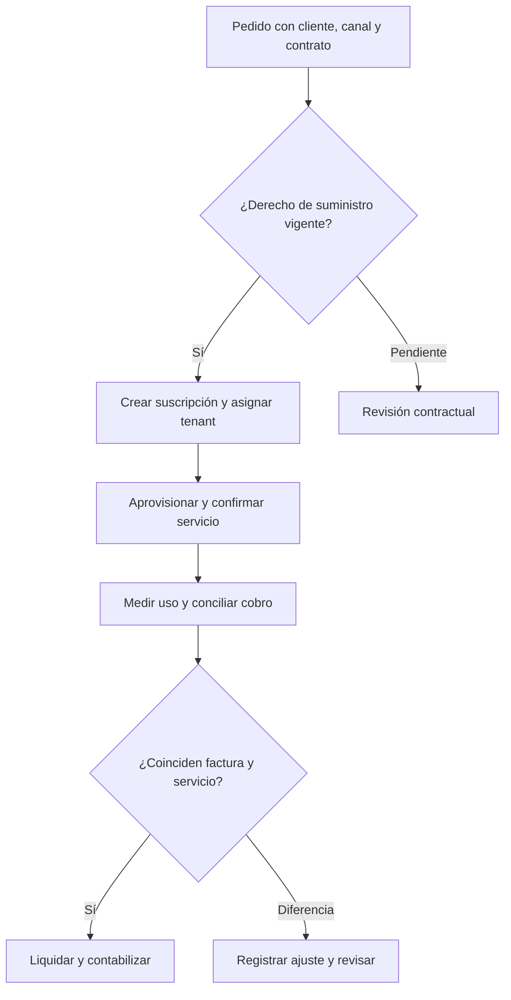

# JUMOCOL MBA · Distribución, aplicaciones y sistemas empresariales

**Informe de investigación independiente para Dirección · Orden 02 · 26 de noviembre de 2026**

**Decisión que habilita este informe.** Dirección recibe tres alternativas por capa y las condiciones para compararlas después de levantar el inventario AS-IS. Una decisión sobre el canal de venta puede tomarse por separado de la decisión sobre dónde ejecutar una aplicación o cómo implantar un ERP. Lo que debe encajar entre ambas son los derechos de suministro, los identificadores de cliente y contrato, los eventos facturables y las responsabilidades de soporte.

| Pregunta de dirección | Resultado de investigación | Evidencia que exigirá la selección |
|---|---|---|
| ¿Quién vende y financia la adquisición? | Referidos, tienda propia y mayorista asignan el precio, la relación contractual y el riesgo de cobro a actores diferentes. | Contratos territoriales, reversión y margen de cohortes con bajas. |
| ¿Qué se entrega al cliente? | Una aplicación instalada en un ecosistema, un servicio alojado y una capacidad consumida por API tienen diferentes dependencias de publicación, aislamiento y medición. | Derecho de distribución, prueba de separación entre empresas y coste a volumen real. |
| ¿Quién responde por la operación empresarial? | La licencia cubre solo una parte del coste. Migración, configuración, capacitación, interfaces y soporte generan trabajo aun cuando el software se aloja externamente. | Alcance funcional probado, conciliación contable, reversibilidad y horas efectivas por cliente. |

## Alcance y lectura de la evidencia

Se conservaron las doce organizaciones de distribución y las diez referencias propuestas para cada una de las otras dos capas. Microsoft se estudia en tres roles. Las 32 unidades de análisis son pares organización–capa. Las 25 variables de Capa 1 proceden de la revisión 1.2. Las de Capas 2 y 3 son instrumentos de esta investigación. El XLSX reúne 800 cruces y un diccionario de 75 entradas. Una observación clasificada como desconocida sigue dentro del universo y queda fuera de cualquier afirmación positiva.

**Trazabilidad.** Se parte del [runtime en el checkpoint autorizado](https://github.com/jmmode/jumocol-os/blob/bcec78b03981d025af89f1a8db24438bf9a36e78/01_CONTEXT/JUMOCOL_MBA_PROJECT_RUNTIME_V1_0.md) y del [benchmark V0.1 de Capa 1](https://github.com/jmmode/jumocol-os/blob/5d5d296e517d3d459b290a2c6fc31ffb9b446785/04_VALIDATION/COMMERCIAL_RESEARCH/CAPA_1_BENCHMARK_Y_MODELOS.md). Los identificadores de las observaciones remiten a documentos o secciones del registro. Una guía de proveedor acredita una función o condición anunciada dentro de su mercado, versión o plan. Un informe financiero acredita lo que la entidad reporta en su perímetro. La existencia de una API, una certificación o un programa comercial por sí sola no acredita la rentabilidad, la compatibilidad de dos productos ni la vigencia de un derecho individual.

**Método de comparación.** Se registra quién paga, qué evento origina la obligación, qué unidad consume recursos, quién asume el coste si hay una cancelación y qué dato permitiría auditar el resultado. Las conclusiones de diseño son inferencias. Las alternativas y las pruebas de aceptación son propuestas. Las simulaciones utilizan parámetros editables y sus resultados son condicionales. Tarifas, licencias y requisitos de publicación requieren nueva comprobación en la fecha y mercado de contratación.

### Cierre de la homologación de Capa 1

El número y el orden de los 25 campos se recuperaron del runtime 1.2 [D-R12]. La versión 0.1 conserva las observaciones primarias y los tres diseños de referencia [D-V01]. La siguiente correspondencia explicita qué se conservó, qué se separó y qué evidencia requirió búsqueda adicional. ND corresponde a un valor sin evidencia suficiente para el mercado y periodo. Una regla contractual describe qué puede ocurrir; no mide el resultado observado.

| Variable original | Campo provisional y decisión de homologación |
|---|---|
| V01 Incorporación | Entrada, rol e instrumento contractual. Separar aceptación y elegibilidad de la tarifa. |
| V02 Costos | Entrada y coste periódico. Distinguir tarifa inicial, renovación, opcionales y precio de producto. |
| V03 Segmentación | Cliente y rol. Separar consumidor preferente, cliente externo, participante y mayorista. |
| V04 Adquisición | Captación, canal y hecho elegible. Contar el cliente final atribuible. |
| V05 Canales | Canal, oferta y venta cruzada. Oferta y catálogo contextualizan el canal. |
| V06 Precios | Parte mayorista de coste periódico, oferta y venta cruzada. Conservar SKU, mercado y base fiscal al comparar. |
| V07 Compensación | Ingreso directo, ingreso adicional y hecho elegible. Identificar base y pagador. |
| V08 Rangos | Rol y hecho elegible eran aproximaciones. Incorporar reglas de posición actual e histórica. |
| V09 Incentivos | Ingreso adicional. Desagregar bonos, reconocimiento y elegibilidad. |
| V10 Recurrencia | Recurrencia, ingreso adicional y cobro. Separar renovación del partner, del cliente y residual. |
| V11 Rentabilidad | Resultados del participante y gasto. Registrar población, exclusiones y costes faltantes. |
| V12 Capacitación | Formación. Indicar cuándo resulta obligatoria para poder cobrar. |
| V13 Documentación | Formación, transparencia e instrumento contractual. Registrar guía, mercado y edición. |
| V14 Liderazgo | Soporte, captación y rol. Distinguir apoyo de canal y patrocinio. |
| V15 Retención de distribuidores | Sin equivalencia directa. El número activo en un corte carece de cohorte de entrada. |
| V16 Retención de clientes | Recurrencia y seguimiento no bastaban. Exigir baja o supervivencia y periodo. |
| V17 Portal | Portal e identidad/cuentas. Registrar permisos y funciones observables. |
| V18 Comisiones | Cobro/liquidación, ajustes y hecho elegible. Regla pública y motor interno se registran por separado. |
| V19 Integraciones | Provisión y seguimiento/integración. Identificar flujo, sistema y evento. |
| V20 Escala | Mercado, catálogo y seguimiento. Un territorio atendido no demuestra capacidad máxima. |
| V21 Cumplimiento | Mercado, instrumento contractual y control de riesgo. Delimitar jurisdicción y régimen. |
| V22 Transparencia | Transparencia y resultados del participante. Contrastar denominadores y divulgación de gastos. |
| V23 Sostenibilidad | Ingreso directo, gasto, ajustes y recurrencia. Añadir exposición a coste comprometido, bajas y liquidez. |
| V24 Fraude y reversión | Ajustes, control de riesgo y cobro/liquidación. Incorporar plazo y auditoría de contracargos. |
| V25 Terminación | Instrumento contractual y control de riesgo. Verificar obligaciones supervivientes, transferencia y reembolso. |

### Evidencia que modifica la lectura de la versión 0.1

**ACN y Utility Warehouse.** ACN separa bonificación por adquisición y comisión por uso. El detalle del plan estadounidense de octubre 2025 tiene valor histórico y la FAQ corporativa confirma que existen gastos y posibles pérdidas [D-A1, D-A2]. UW publica reglas reproducibles que matizan la frase «comisión mientras permanece el cliente». La guía de febrero 2026 condiciona el residual a identidad verificada, formación, actividad y estado. Su ejemplo de propietario con dos servicios adelanta el bono y difiere el residual de energía y banda ancha al mes 36; el seguro puede devengar desde el primer mes. El ajuste automático del bono opera en ambos sentidos durante 90 días. La distinción evita sumar un anticipo y todos los meses de residual como si fueran cobros independientes. La rentabilidad del partner sigue sin distribución neta pública en estas fuentes [D-U1, D-U2]. En el semestre a septiembre de 2026 Telecom Plus informó 13,2 % de bajas anualizadas frente a 14,2 % del ejercicio anterior y beneficio ajustado antes de impuestos de GBP 14,6 millones frente a 32,5 millones en el semestre comparable. El agregado del grupo no permite atribuir la variación a un bono o establecer ganancias individuales [D-U3].

**Ingreso observable y rentabilidad.** Nu Skin publicó para EE. UU. 2025 USD 178,75 de comisión mensual promedio por afiliado activo frente a USD 670,04 por perceptor. El 26,67 % de los activos percibió un pago en el mes medio; multiplicar 670,04 por 0,2667 recupera aproximadamente 178,70 sujeto al redondeo. Se excluyen el gasto y el margen de reventa. Herbalife actualizó retrospectivamente el enlace de V0.1: la declaración publicada en junio de 2026 corresponde a 2025, con aproximadamente 47.000 perceptores en un mes típico. Los USD 166 para primer año son el umbral superado por la mitad de perceptores de ese subgrupo, no la ganancia mediana de todos los inscritos. Mary Kay Canadá incluye perceptores y no perceptores: la participante típica recibió cero comisiones o bonos en 2025, pero la divulgación excluye beneficio de reventa. Estas poblaciones, productos y mercados impiden ordenar compañías por «ganancia típica» con un único promedio. La FTC documenta omisiones frecuentes de ceros y gastos en 70 declaraciones estadounidenses [D-NU, D-HE, D-MK, D-FTC].

**Medición propuesta.** Para cada participante y periodo: ingreso neto de explotación = cobros de clientes externos − coste del producto vendido + comisiones efectivamente cobradas − devoluciones no compensadas − gastos − cuotas. Si el proveedor cobra la venta y remite sólo una comisión, registrar esa comisión una vez; evitar contar otra vez la venta. Separar flujo de caja, inventario, horas y coste de oportunidad. Publicar P10, mediana, P90, proporción con resultado ≤0, horas y abandono a 12 meses sobre cohorte de altas que incluye ceros. Anonimizar antes de agregar. Para separar retención e incorporación, supervivencia de distribuidores al mes t = activos observados de la cohorte original / altas de esa cohorte con seguimiento completo; si el seguimiento es incompleto, estimar supervivencia con censura y explicitar el método.

### Topología comercial y viabilidad

| Estructura | Regla reproducible | Qué revela la prueba |
|---|---|---|
| Binaria | La guía estadounidense de USANA documenta dos ramas. Para centro cualificado y pares dentro del rango ilustrado, con M = mínimo de los puntos elegibles izquierdo y derecho, comisión semanal de ejemplo = 0,20 × M cuando M ≥125. Los remanentes y redondeos tienen reglas propias. | A igual volumen total de 1.000 puntos, 500/500 genera 100 puntos de comisión y 800/200 genera 40. La diferencia es de distribución del volumen; el excedente puede trasladarse. Registrar puntos de consumo propio y de ventas externas por separado. [D-BIN] |
| Unilevel | Modelo teórico con amplitud abierta. Para profundidad pagable d, C = suma de rⱼ × Vⱼ, con Vⱼ ventas elegibles netas en generación j; los límites de pago son distintos de la profundidad genealógica. Ejemplo hipotético: 1.000 y 500 u.m. a 5 % y 2 % = 60. | Si las devoluciones elegibles son del 20 % en ambas generaciones, C baja a 48. El presupuesto debe contar cuántas veces la misma venta genera comisión a distintos ancestros. Avon documenta pagos generacionales por título, pero ese hecho aislado no establece que todo su plan sea unilevel puro. [D-MLM, D-AV26] |
| Matriz de ancho b y profundidad d | Máximo de posiciones descendientes = suma de bʲ para j de 1 a d. En 3 × 4 resultan 120 posiciones; la raíz no se cuenta. Hipótesis de ocupación uniforme 50 % y venta externa 20 u.m. por plaza ocupada: 1.200 u.m. de volumen. | A 5 % uniforme de volumen elegible la comisión hipotética son 60 u.m.; con ocupación 25 % son 30. La capacidad es combinatoria, no una proyección de ventas ni garantía de reparto. Ninguna de las doce referencias se etiqueta como matriz forzada sin contrato probatorio. [D-MLM] |
| Mayorista | Margen = puestos cobrados × (precio − soporte variable) − puestos comprometidos × coste proveedor − fijo. | La regla CSP para software elegible limita cancelación a siete días con excepciones; un cliente moroso puede dejar una obligación de plazo completo. Pax8 mantiene determinados compromisos tras la terminación. Simular impago, desfase de caja y coste de transferencia independientemente. [D-MSC, D-PX2] |

**Método de implementación propuesto.** Versionar el plan por territorio y fecha de devengo; registrar cliente, pedido, proveedor, venta externa/consumo propio y reversión. Separar patrocinio y colocación con vigencias históricas. Procesar altas y ajustes con clave de idempotencia y libro de movimientos que anule mediante contrapartida. Probar cambio de rango a mitad de periodo, devolución parcial posterior al pago, reintento de webhook, rama desequilibrada, doble atribución y baja del canal con suscripción vigente. Reconciliar margen antes de ampliar la red: indicador = (margen tras suministro, cobro y soporte − pagos netos del canal) / ingreso externo neto. Un porcentaje de comisión por sí solo no demuestra solvencia.

**Conservación de las alternativas A, B y C.** A mantiene operador central, captación atribuida y residual condicionado: incorporar calendario explícito de anticipos, reversión y aplazamiento [D-U2]. B conserva tienda de marca propia y margen de reventa: revisar titularidad y portabilidad al cesar, DPA, contracargos y licencia anual [D-GDC]. C conserva mayorista B2B y revendedor especializado: conciliar puestos comprados, asignados, cobrados y recuperables, con autorización de canal y límite de crédito [D-MSC, D-PX2]. La evidencia amplía los controles y conserva las tres arquitecturas comerciales.

**Consideración jurídica.** En Colombia la clasificación exige contrastar los elementos concurrentes de la Ley 1700 de 2013 con las características reales de la operación. En EE. UU., el acuerdo de la FTC con Herbalife en 2016 se refiere a esa organización y territorio. La forma geométrica del árbol o la etiqueta «partner» por sí solas son insuficientes para concluir conformidad. Antes de un eventual lanzamiento corresponden revisión jurídica específica del producto, territorio, contratos, derechos de suministro y evidencia del incentivo económico [D-CO, D-CO2, D-HX].

**Límite del cierre documental.** Quedan homologadas doce organizaciones y 25 variables, con evidencia y lagunas señaladas. La ausencia de cuentas individuales completas, churn de cohortes por distribuidor, tasas mayoristas negociadas y contratos privados impide verificar una rentabilidad neta común o atribuir causalidad a un incentivo. Las cifras ilustrativas permiten reproducir mecanismos, no estimar rendimientos reales.

### Capa 2 · Aplicaciones, canales y costes de ejecución

**Resultado.** Las diez referencias representan decisiones distintas. Apple y Shopify controlan acceso a usuarios o tiendas. Google y Microsoft conectan un derecho comercial con una aplicación publicada. Cloudflare y Vercel ejecutan aplicaciones de terceros. OpenAI y Twilio entregan capacidades medibles mediante API. Bubble y FlutterFlow reducen el trabajo de construcción con consecuencias diferentes al salir. Una comparación global por número de funciones favorecería al proveedor con mayor catálogo, aun cuando su producto resolviera otro problema. Las 25 variables se aplican al alcance de producto identificado en cada fila. Solo los hechos referenciados intervienen en la síntesis. ND significa que no se acreditó la capacidad o el dato para ese alcance.

**Quién controla el alta.** En Google un cambio solicitado genera una notificación y la aplicación puede verificar el estado del entitlement con la API. Microsoft diferencia compra, activación, suspensión y cancelación. El inicio de facturación varía entre la activación manual y automática. Vercel admite eventos de creación y pago de factura. La misma palabra «activo» puede referirse al derecho comprado, la cuenta provisionada o la factura pagada. Como propuesta, el integrador debe guardar el identificador de pedido, empresa, suscripción y evento por separado, reconciliar los estados y poder repetir el procesamiento sin duplicar cargos. La prueba debe incluir cancelación al cierre de ciclo y llegada de un pago después de una suspensión. [L2-GO3, L2-MI3, L2-VE3]

**Qué separa a dos clientes.** Azure permite compartir recursos o agrupar empresas en despliegues repetibles. Cloudflare aísla scripts de clientes en un namespace y recomienda separar entornos de desarrollo y producción. Vercel documenta una aplicación compartida con muchos dominios y un modo multiproyecto. La subcuenta de Twilio separa recursos sin trasladar automáticamente la obligación económica fuera de la cuenta principal. El dominio propio, la subcuenta de comunicaciones y la entidad legal del cliente necesitan una correspondencia explícita. La guía de NIST sitúa los controles de acceso en responsabilidades distintas según el modelo SaaS, PaaS o IaaS. Para aceptar el aislamiento propuesto, medir cero lecturas cruzadas en pruebas con dos empresas y documentar roles de soporte y restauración. [L2-MI1, L2-CF2, L2-VE2, L2-TW1, L2-VI]

**Canal y propiedad.** La revisión de Apple restringe la presentación de aplicaciones generadas por plantilla; la sección 4.2.6 condiciona la presentación individual al proveedor de contenido y contempla un modelo de aplicación agregada. En Shopify existen vías pública y personalizada con admisión diferente. Tener acceso al canal o al programa de partners no otorga por sí mismo derechos de sublicencia. Bubble documenta la reconstrucción de lógica para salir del runtime. FlutterFlow permite exportar el código en un plan habilitado, mientras la aplicación sigue dependiendo de reglas del backend, bibliotecas y cuentas de tiendas. Evaluar la salida exige ejecutar una versión independiente y recuperar datos, secretos y reglas mediante procedimientos autorizados. [L2-AP4, L2-AP5, L2-SH1, L2-SH7, L2-BU4, L2-FL2, L2-FL6, L2-FL8]

**Tres alternativas.** (A) SaaS multiempresa con una versión compartida. La suscripción y el dominio se vinculan al tenant, y las funciones se habilitan por plan. Una base común amortiza costes mientras una aplicación lenta puede afectar a otros clientes. Medir latencia p95 por tenant, coste por cuenta activa y errores de aislamiento. (B) Aplicación empaquetada y distribuida mediante marketplace, con backend del editor. La venta puede beneficiarse del canal, y el editor asume revisión, cambios de política y costes de integración. Iniciar la prueba con instalación, cambio de plan y desinstalación completos. Desglosar devoluciones, comisión y soporte. (C) Servicio especializado vía API o agentes. Credencial por proyecto, medición por operación, límite de gasto y revisión de excepciones. La unidad facturable debe poder vincularse a un resultado útil y un costo. Probar límites, reintentos y recuperación ante indisponibilidad del proveedor. Son propuestas de investigación. Las bases observadas son los despliegues Azure y Vercel para A, los canales Apple, Shopify, Microsoft y Google para B y OpenAI, Twilio y Workers para C. [L2-MI1, L2-VE2, L2-AP4, L2-SH2, L2-MI3, L2-GO3, L2-OA1, L2-TW5, L2-CF1]

**Cómo leer el coste.** En Workers for Platforms la tarifa publicada permite reproducir una cuenta concreta en USD al mes: 25 + 0,30 × max(0, solicitudes − 20 M)/1 M + 0,02 × max(0, ms CPU − 60 M)/1 M + 0,02 × max(0, scripts − 1.000). Con 40 M solicitudes, 160 M ms y 1.100 scripts resulta 35 USD por los conceptos incluidos. Con 80 M solicitudes, 320 M ms y los mismos scripts son 50,20 USD. Quedan fuera bases de datos, egreso de servicios relacionados, soporte, impuestos y desarrollo. Para una API de agentes, si el coste medio por intento es c y la fracción de intentos aceptados es p, el coste medio por resultado aceptado es c/p bajo un patrón estable de reintentos. Con c = 0,02 USD y p = 80 % alcanza 0,025 USD; con p = 50 % sube a 0,04 USD. Estas últimas cifras son supuestos didácticos, no tarifas ni desempeño de proveedores. En Twilio el uso puede facturarse por segmentos; en Shopify el límite técnico puede depender del coste de la consulta. Ambas unidades deben medirse separadas del número de clientes. [L2-CF1, L2-OA3, L2-TW5, L2-SH5]

**Límites de evidencia.** Se verificaron mecanismos en documentación y contratos públicos. Permanecen sin medir latencia real, gasto del editor, conversión del marketplace, tiempos de revisión, margen realizado y condiciones negociadas. El cargo de Apple del programa pequeño solo aplica a operaciones elegibles. Las publicaciones de agencias Bubble y el DPA de Vercel indicados como históricos requieren versionado contractual en una implantación concreta. La política anunciada para el 1 de diciembre en Shopify es posterior al corte. [L2-AP1, L2-BU6, L2-VE8, L2-SH6]

## Capa 3 · Sistemas empresariales e implantación

Las diez referencias abarcan tres trabajos distintos. OneWorld, Business Central y ERPNext documentan funciones financieras para varias entidades. Salesforce y HubSpot concentran la gestión de clientes. ServiceNow y n8n coordinan acciones empresariales. Para evaluar estos últimos como intermediarios, la prueba decisiva es reconstruir qué disparó una acción, con qué autorización se ejecutó y cómo se concilió con el sistema contable. [B2-1, B6-2, B10-3, B3-3, B7-2, B9-1, B8-2]

| Familia de decisión | Fortaleza observada | Riesgo o vacío | Criterio propuesto |
|---|---|---|---|
| ERP multiempresa | NetSuite define subsidiarias dentro de una cuenta y Business Central documenta la consolidación del mayor. Odoo permite compartir datos entre sociedades de una base. | Una compañía operativa y un tenant de clientes externos tienen fronteras distintas. El plan puede cambiar al activar multiempresa. | Conciliar dos entidades con monedas y roles distintos y revisar el precio de la edición resultante. [B2-1, B6-2, B4-1] |
| CRM y automatización comercial | Salesforce delimita acciones sobre cuentas, HubSpot publica condiciones por licencia y Zoho especifica límites de Zia por función. | La licencia de usuario y el volumen de eventos pueden crecer a ritmos diferentes. | Estimar coste por cuenta activa y retener registro de cambios de datos comerciales. [B3-1, B7-3, B5-2] |
| Orquestación e integración | ServiceNow combina decisiones, SLA y auditoría en playbooks. n8n ofrece ejecución distribuida y Frappe documenta APIs de recursos. | Una ejecución técnica satisfactoria puede dejar una operación financiera pendiente de conciliación. | Repetir mensajes y comprobar unicidad del resultado, trazabilidad y atención de excepciones. [B9-1, B8-2, B10-1] |

**Implantación y escala.** SAP usa talleres fit-to-standard para demostrar el proceso antes de definir diferencias. Odoo asigna al líder de proyecto la evaluación de personalizaciones. Microsoft divide el ciclo en descubrimiento, inicio, implementación, preparación y operación. ServiceNow explicita pruebas y preparación operativa antes de la salida. Como método de referencia, conviene convertir cada excepción en una decisión con responsable, estimación de esfuerzo y prueba de aceptación. Consolidar excepciones recurrentes en una plantilla sectorial solo después de medir cuánto reduce el coste de implantaciones posteriores. [B1-6, B4-6, B6-4, B9-4]

**Economía y límites.** Los documentos de Oracle permiten identificar servicios de activación específicos de Colombia. Frappe distingue el alojamiento del trabajo del implementador. Un presupuesto comparable debe sumar migración, configuración, interfaces, capacitación y soporte posarranque, e indicar qué cambios reabren el alcance. La muestra no proporciona una serie comparable de beneficio neto realizado por implementador. El libro ensaya explícitamente una desviación del coste de entrega y una caída de unidades cobradas. [B2-4, B10-4]

**Riesgo de canal.** Las credenciales pueden corresponder al producto integrado, a una persona o a toda la organización. SAP ICC certifica integraciones. HubSpot establece prerrequisitos para acreditaciones y Frappe documenta condiciones sobre el equipo certificado. Antes de comparar partners hay que registrar el titular y el alcance de la acreditación. En n8n, los derechos necesarios para exponer el editor al cliente dependen del uso y del contrato aplicable. [B1-4, B7-4, B10-5, B8-1]

## Nueve modelos independientes y sus contratos de integración

| Código | Alternativa | Unidad económica | Riesgo y fortaleza | Base |
|---|---|---|---|---|
| 1A | Referidos con operador central | Servicio activo/mes y adquisición confirmada | Poca infraestructura por asesor. Menor control sobre precio. | R01, R13 |
| 1B | Tienda digital de marca propia | Pedido neto de devoluciones | Control de precio. La cuota fija penaliza la baja rotación. | R02 |
| 1C | Mayorista B2B para operadores especializados | Puesto comprometido frente a puesto cobrado | Integración compartida. El impago consume margen y circulante. | R03, R04 |
| 2A | Aplicación distribuida por marketplace | Instalación de pago/mes | Descubrimiento compartido. Dependencia de revisión y política de cobros. | R05, R16 |
| 2B | SaaS de marca configurable por tenant | Tenant de pago/mes | Reutiliza una versión. La personalización específica puede fragmentarla. | R08, R09 |
| 2C | API de capacidades por consumo | Mil operaciones facturables | Integra distintas aplicaciones. Variabilidad de demanda y coste. | R06, R07 |
| 3A | Suite ERP/CRM implantada por especialistas | Proyecto de alcance fijo entregado | Configuración integral. Riesgo de desviación en proyectos a precio fijo. | R10, R12 |
| 3B | ERP vertical gestionado por suscripción | Empresa gestionada/mes | Coste repartido entre clientes. Variantes y localizaciones elevan mantenimiento. | R09, R10 |
| 3C | Automatización gestionada sobre sistemas existentes | Flujo gestionado/mes con consumo y excepciones | Adopción incremental. Atención de excepciones puede agotar el margen. | R04, R11, R12 |
 
### Arquitectura de referencia

La topología comercial determina quién factura, pero los tres modelos de distribución necesitan relacionar pedido, derecho, suministro y liquidación. El catálogo, el registro de identidades y el libro de ajustes son dependencias compartidas. La interoperabilidad se evalúa en 27 pares posibles entre capas, cada uno con una condición y un ensayo de aceptación. La clasificación refleja compatibilidad de diseño pendiente de ensayo.

### Economía de los modelos

Para el mes analizado, el resultado operativo ilustrativo es **Q × [P × (1 − t) − v] − S × c − F**. Q son unidades cobradas, S unidades de suministro, P precio, t participación del canal, v coste operativo por unidad cobrada, c coste por unidad suministrada y F coste fijo mensual. El umbral de equilibrio del libro supone Q = S. Al comprometer capacidad por adelantado, el escenario calcula Q y S por separado. El resultado excluye impuestos, financiación y partidas no incorporadas en los supuestos.

| Modelo | Resultado base (UM/mes) | Si el volumen cobrado baja 10 % | Si el suministro cuesta 25 % más |
|---|---:|---:|---:|
| 1A | 240 | 120 | 90 |
| 1B | 25 | -26 | -50 |
| 1C | 0 | -390 | -750 |
| 2A | 270 | 138 | 232.5 |
| 2B | 200 | -120 | 50 |
| 2C | 600 | 150 | 225 |
| 3A | 4000 | -7400 | -1550 |
| 3B | 900 | 270 | 450 |
| 3C | 600 | 120 | 450 |

En 1C, 300 puestos a coste 10 siguen generando 3.000 unidades de coste aunque solo se cobren 270. Con precio 15, atención variable 2 y coste fijo 900, el margen operativo pasa de cero a −390. En 3A, tres proyectos a precio cerrado y la pérdida de uno de los cobros producen un salto discreto. El simulador redondea las unidades indivisibles hacia abajo y admite fracciones en miles de operaciones API. Los importes corresponden a hipótesis diseñadas para ensayar la exposición, sin extrapolación a ningún proveedor.

### Criterios para seleccionar una arquitectura integral tras el diagnóstico

Primero se comprueban derechos territoriales, licencias por uso, aislamiento de clientes, recuperación de datos y conciliación financiera. Una alternativa que incumple un requisito obligatorio queda pendiente hasta acreditar la corrección. Entre alternativas admisibles, comparar margen en escenario adverso, capital de trabajo, esfuerzo de migración, tiempo hasta la primera activación cobrada, coste de soporte y coste de salida. Dirección podrá ponderar esos criterios después de conocer capacidades y restricciones verificadas. Una puntuación sin datos reales produciría una precisión aparente.

## Pruebas de interoperabilidad para la siguiente decisión

| Ensayo propuesto | Procedimiento reproducible | Evidencia mínima para aprobar |
|---|---|---|
| Venta y alta | Enviar dos veces el mismo pedido y repetir tras un fallo intermedio del proveedor. | Una sola suscripción y una sola obligación de pago. Registro de la excepción y su resolución. |
| Cambio contractual | Simular una baja parcial y una devolución después del cierre del periodo. | El asiento de ajuste enlaza la factura, el periodo, el contrato y la liquidación anterior. |
| Separación de empresas | Usar dos tenants de prueba, con roles distintos, para verificar visibilidad, exportación y límites por cuenta. | Pruebas de acceso autorizadas por rol, exportación de los datos propios y registro de auditoría. |
| Consumo de API e IA | Reproducir una carga de referencia; variar el volumen, el tamaño de entrada y la proporción de reintentos. | Coste por operación útil, latencia percentil 95 y regla verificable de corte de gasto. |
| Salida del proveedor | Exportar datos y configuración, restaurar un conjunto de prueba y conciliar entidades y saldos. | Tiempo de recuperación, totales de control, permisos restaurados y alcance de los datos no portables. |

**Evidencia transversal.** Para priorizar costes por unidad de negocio, distribuir la infraestructura compartida según consumo y exponer el coste no asignado [G3]. Para agentes con permiso de actuar, documentar qué decisiones pueden ejecutar, cómo se evalúan y dónde interviene un responsable humano [G2]. La portabilidad requiere verificar formatos, identidades, semántica y operaciones en el destino [G5]. La auditoría histórica de GAO sobre conversión de datos respalda conservar controles y aprendizajes de migración; su contexto es el sector público estadounidense [G4]. En Colombia, la Superintendencia de Sociedades señala expresamente que la mera vinculación de personas a una red multinivel no puede originar compensación [G1]. Cada oferta y territorio requiere validación jurídica propia antes de lanzamiento.

## Control documental y decisión pendiente

| Elemento | Registro |
|---|---|
| Origen metodológico | 00 · MBA — Dirección y arquitectura, runtime revisión 1.2, commit bcec78b03981d025af89f1a8db24438bf9a36e78. |
| Resultado entregado | Matriz maestra editable e informe maestro en un mismo commit bajo 04_VALIDATION/COMMERCIAL_RESEARCH/. El commit identifica la versión conjunta. |
| Cierre de investigación | Se entrega el estudio documental de las tres capas con brechas explícitas. Las variables sin evidencia pública no reciben valores imputados. |
| Decisión reservada | Dirección revisa el checkpoint y autoriza, si procede, el levantamiento AS-IS. La propuesta integral TO-BE dependerá de esa información y de pruebas técnicas, económicas y jurídicas. |

## Fuentes y documentos de consulta

El identificador enlaza la observación en el libro con el documento consultado. En documentación dinámica, el corte identifica la consulta; no acredita disponibilidad contractual futura.

### Capa 1

- **D-A1** · ACN · [ACN, declaración de ingresos y catálogo de soporte, EE. UU.](https://www.acn.com/us-en/faqs) · Consultado 26/11/2026 · ACN, declaración de ingresos y catálogo de soporte, EE. UU.
- **D-A2** · ACN · [ACN, plan estadounidense, edición octubre 2025 alojada externamente. Uso histórico, tarifa vigente sin confirmar.](https://s3.amazonaws.com/kajabi-storefronts-production/file-uploads/sites/20689/themes/2162859280/downloads/d0c7b1-f8b7-b34-c4e5-b57ab033c200_Compensation_Plan_Overview-USEN_OCT25.pdf) · Consultado 26/11/2026 · ACN, plan estadounidense, edición octubre 2025 alojada externamente. Uso histórico, tarifa vigente sin confirmar.
- **D-U1** · Utility Warehouse · [UW, oferta de participación y bono condicionado.](https://uw.co.uk/partner) · Consultado 26/11/2026 · UW, oferta de participación y bono condicionado.
- **D-U2** · Utility Warehouse · [UW, guía, sección «Auto-top ups and clawbacks».](https://opguide.uw.co.uk/) · Consultado 26/11/2026 · Reino Unido, febrero 2026
- **D-U3** · Telecom Plus · [Telecom Plus, resultados H1 FY27 publicados el 24/11/2026, semestre terminado el 30/09.](https://www.telecomplus.co.uk/~/media/Files/T/Telecomplus/documents/h1-fy27-results-report.pdf) · Consultado 26/11/2026 · Telecom Plus, resultados H1 FY27 publicados el 24/11/2026, semestre terminado el 30/09.
- **D-AM** · Amway · [Amway, declaración EE. UU. 2025.](https://www.amway.com/en_US/income-disclosure) · Consultado 26/11/2026 · Amway, declaración EE. UU. 2025.
- **D-HE** · Herbalife · [Declaración de resultados típicos 2025, publicada en junio 2026](https://www.herbalife.com/content/dam/global-reusable-assets/documents/pd-statement-typical-distributor-earnings-en-us.pdf) · Consultado 26/11/2026 · EE. UU., actualización junio 2026 sobre 2025
- **D-AV** · Avon · [Avon, guía EE. UU. 2024, antecedente histórico.](https://www.avon.com/magnoliaPublic/dam/jcr%3A9441aabd-1662-46a6-bf82-72892e85a57f/avon-2024-career-and-compensation-guide-en-v2.pdf) · Consultado 26/11/2026 · Avon, guía EE. UU. 2024, antecedente histórico.
- **D-NU** · Nu Skin · [Nu Skin, resumen EE. UU. 2025.](https://www.nuskin.com/content/dam/office/n_america/US/en/business_materials/distearnings.pdf) · Consultado 26/11/2026 · Nu Skin, resumen EE. UU. 2025.
- **D-MK** · Mary Kay · [Mary Kay, declaración Canadá 2025.](https://www.marykay.ca/-/media/images/mk/united-states/canada/esuite/footer/canadian-statement-of-typical-participant-earnings-2025.pdf) · Consultado 26/11/2026 · Canadá 2025; PDF indexado, acceso directo intermitente
- **D-US** · USANA · [USANA, 10-K presentado en marzo 2025, riesgos de capital humano.](https://ir.usana.com/sec-filings/annual-reports/content/0000896264-25-000092/0000896264-25-000092.pdf) · Consultado 26/11/2026 · 10-K FY2024
- **D-IC** · inCruises · [Oferta de participación](https://account.incruises.com/partnership) · Consultado 26/11/2026 · Texto en inglés; acuerdo 29/01/2026
- **D-IC2** · inCruises · [Independent Partner Agreement](https://files.incruises.com/files/en/104EN_3.2_INDEPENDENT_PARTNER_AGREEMENT.pdf) · Consultado 26/11/2026 · Texto en inglés; acuerdo 29/01/2026
- **D-MS** · Microsoft CSP · [Microsoft, requisitos y distribución indirecta.](https://learn.microsoft.com/en-us/partner-center/enroll/new-indirect-reseller-requirement) · Consultado 26/11/2026 · Microsoft, requisitos y distribución indirecta.
- **D-PX** · Pax8 · [Integración PSA](https://www.pax8.com/en-us/marketplace/psa-integrations/) · Consultado 26/11/2026 · Portal EE. UU.; términos 15/09/2026
- **D-PX2** · Pax8 · [Partner Terms](https://www.pax8.com/en-us/terms/partner-terms/) · Consultado 26/11/2026 · Portal EE. UU.; términos 15/09/2026
- **D-GD** · GoDaddy · [GoDaddy, programa y ejemplo económico.](https://www.godaddy.com/reseller-program) · Consultado 26/11/2026 · GoDaddy, programa y ejemplo económico.
- **D-GD2** · GoDaddy · [GoDaddy, programa y ejemplo económico.](https://www.godaddy.com/es/help/tips-for-setting-product-prices-in-the-reseller-storefront-40411?lc=en-US) · Consultado 26/11/2026 · GoDaddy, programa y ejemplo económico.
- **D-FTC** · FTC · [EE. UU., estudio de 70 declaraciones, 2024.](https://www.ftc.gov/system/files/ftc_gov/pdf/2024-08-19-mlm-ids-staff-report.pdf) · Consultado 26/11/2026 · EE. UU., estudio de 70 declaraciones, 2024.
- **D-BIN** · USANA · [Understanding your USANA business, pp. 2–4](https://www.usana.com/static/images/na/Training/WelcomeKit/CompensationPlanInsert-USEN.pdf) · EE. UU., PDF sin fecha editorial visible
- **D-MLM** · PLOS ONE · [An economic model of multi-level marketing, artículo teórico revisado por pares](https://doi.org/10.1371/journal.pone.0253700) · 20/07/2021, modelo teórico
- **D-CO** · Superintendencia de Sociedades · [Actividad multinivel, criterios de supervisión](https://www.supersociedades.gov.co/actividad-multinivel) · Colombia, consulta 26/11/2026
- **D-CO2** · Congreso de Colombia · [Ley 1700 de 2013, texto normativo](https://www.cancilleria.gov.co/sites/default/files/Normograma/docs/ley_1700_2013.htm) · Colombia, 2013
- **D-HX** · FTC · [Herbalife, acuerdo y reestructuración de operaciones en EE. UU.](https://www.ftc.gov/news-events/news/press-releases/2016/07/herbalife-will-restructure-its-multi-level-marketing-operations-pay-200-million-consumer-redress) · EE. UU., 15/07/2016, antecedente histórico
- **D-AV26** · Avon · [2026 Compensation Guide, pp. 1–3 y tablas de título](https://www.avon.com/magnoliaPublic/dam/pdf/2026/guides/avon-2026-career-and-compensation-guide-en.pdf) · EE. UU., campañas 2026
- **D-MSS** · Microsoft · [Security requirements for Partner Center](https://learn.microsoft.com/en-us/partner-center/security/security-requirements) · Programa CSP, requisitos desde octubre 2025
- **D-MSC** · Microsoft · [Sell software subscriptions through CSP, cancelación](https://learn.microsoft.com/en-us/partner-center/customers/csp-software-subscriptions) · CSP, software elegible, consulta 26/11/2026
- **D-GDC** · GoDaddy · [Reseller Agreement, cláusulas de precio, soporte, comisión y terminación](https://www.godaddy.com/legal/agreements/reseller-agreement) · Portal EE. UU., consulta 26/11/2026
- **D-AC21** · ACN · [Políticas y procedimientos del IBO](https://acn.com/documents/legal/USPP_SP_ADA_9.01.21.pdf) · EE. UU., traducción española 2021, histórica
- **D-U4** · Utility Warehouse · [Fiche de partner alojada por UW, nota legal sobre gastos](https://partner.uw.co.uk/partner/jacqueline-drew-am7559) · Reino Unido, condiciones mostradas en el sitio; 26/11/2026
- **D-AM2** · Amway · [2025 U.S. Income Disclosure, versión PDF, cifras antes de gastos](https://www.amway.com/medias/AmwayIncomeDisclosure-USEN.pdf?context=bWFzdGVyfHBkZnw0MjU0MTJ8YXBwbGljYXRpb24vcGRmfHN5cy1tYXN0ZXIvcGRmL2g0Yy9oOWYvMTAzOTMyNjQ5MTQ0NjIvQW13YXlJbmNvbWVEaXNjbG9zdXJlX1VTRU4ucGRmfGUzNDg3ODU0NjhiZGVmN2Q0NzZlMWZmOWNjOGQ4MjhkZDNlNzJiNGJmYWY4ZmQ2NjJlYzE3YjhhMWMxY2FkNDA) · EE. UU., ejercicio 2025
- **D-R12** · JUMOCOL · [Runtime revisión 1.2, diccionario original](https://github.com/jmmode/jumocol-os/blob/bcec78b03981d025af89f1a8db24438bf9a36e78/01_CONTEXT/JUMOCOL_MBA_PROJECT_RUNTIME_V1_0.md) · 26/11/2026
- **D-V01** · JUMOCOL · [Benchmark de continuidad v0.1](https://github.com/jmmode/jumocol-os/blob/5d5d296e517d3d459b290a2c6fc31ffb9b446785/04_VALIDATION/COMMERCIAL_RESEARCH/CAPA_1_BENCHMARK_Y_MODELOS.md) · 26/11/2026

### Capa 2

- **L2-GO1** · Google · [Cloud Run documentation  |  Google Cloud Documentation](https://docs.cloud.google.com/run/docs) · Documentación consultada el 26/11/2026; sin versión fijada · Cloud Marketplace, habilitación territorial según oferta
- **L2-GO2** · Google · [Offering software as a service (SaaS) products  |  Google Cloud Marketplace Partners  |  Google Cloud Documentation](https://docs.cloud.google.com/marketplace/docs/partners/integrated-saas) · Documentación consultada el 26/11/2026; sin versión fijada · Cloud Marketplace, habilitación territorial según oferta
- **L2-GO3** · Google · [Manage customer entitlements for your SaaS product  |  Google Cloud Marketplace Partners  |  Google Cloud Documentation](https://docs.cloud.google.com/marketplace/docs/partners/integrated-saas/manage-entitlements) · Documentación consultada el 26/11/2026; sin versión fijada · Cloud Marketplace, habilitación territorial según oferta
- **L2-AP1** · Apple · [App Store Small Business Program - Apple Developer](https://developer.apple.com/app-store/small-business-program/) · Documentación consultada el 26/11/2026; sin versión fijada · programa y tienda por país; porcentaje sujeto a términos locales
- **L2-AP2** · Apple · [Apple Developer Program License Agreement - Agreements and Guidelines - Support - Apple Developer](https://developer.apple.com/support/terms/apple-developer-program-license-agreement/) · Documentación consultada el 26/11/2026; sin versión fijada · programa y tienda por país; porcentaje sujeto a términos locales
- **L2-AP3** · Apple · [App Store Connect API | Apple Developer Documentation](https://developer.apple.com/documentation/AppStoreConnectAPI) · Documentación consultada el 26/11/2026; sin versión fijada · programa y tienda por país; porcentaje sujeto a términos locales
- **L2-MI1** · Microsoft · [Architectural Approaches for a Multitenant Solution - Azure Architecture Center | Microsoft Learn](https://learn.microsoft.com/en-us/azure/architecture/guide/multitenant/approaches/overview) · Documentación consultada el 26/11/2026; sin versión fijada · Azure/Marketplace, disponibilidad según oferta
- **L2-MI2** · Microsoft · [Architectural Approaches for the Deployment and Configuration of Multitenant Solutions - Azure Architecture Center | Microsoft Learn](https://learn.microsoft.com/en-us/azure/architecture/guide/multitenant/approaches/deployment-configuration) · Documentación consultada el 26/11/2026; sin versión fijada · Azure/Marketplace, disponibilidad según oferta
- **L2-MI3** · Microsoft · [Managing the SaaS subscription life cycle - Marketplace publisher | Microsoft Learn](https://learn.microsoft.com/en-us/partner-center/marketplace-offers/pc-saas-fulfillment-life-cycle) · Documentación consultada el 26/11/2026; sin versión fijada · Azure/Marketplace, disponibilidad según oferta
- **L2-MI4** · Microsoft · [Transacting on Microsoft Marketplace - Marketplace publisher | Microsoft Learn](https://learn.microsoft.com/en-us/partner-center/marketplace-offers/transacting-commercial-marketplace) · Documentación consultada el 26/11/2026; sin versión fijada · Azure/Marketplace, disponibilidad según oferta
- **L2-SH1** · Shopify · [Select a distribution method](https://shopify.dev/docs/apps/launch/distribution/select-distribution-method) · Documentación consultada el 26/11/2026; sin versión fijada · plataforma global, acceso sujeto al tipo de distribución
- **L2-SH2** · Shopify · [About billing for your app](https://shopify.dev/docs/apps/launch/billing) · Documentación consultada el 26/11/2026; sin versión fijada · plataforma global, acceso sujeto al tipo de distribución
- **L2-SH3** · Shopify · [Access tokens](https://shopify.dev/docs/apps/build/authentication-authorization/access-tokens) · Documentación consultada el 26/11/2026; sin versión fijada · plataforma global, acceso sujeto al tipo de distribución
- **L2-SH4** · Shopify · [Create a webhook subscription](https://shopify.dev/docs/apps/build/webhooks/get-started?deliveryMethod=eventBridge&framework=remix) · Documentación consultada el 26/11/2026; sin versión fijada · plataforma global, acceso sujeto al tipo de distribución
- **L2-OA1** · OpenAI · [Tracing | OpenAI API](https://developers.openai.com/api/docs/guides/agents-api/tracing) · Documentación consultada el 26/11/2026; sin versión fijada · API en territorios admitidos, sujeto a elegibilidad
- **L2-OA2** · OpenAI · [Using tools | OpenAI API](https://developers.openai.com/api/docs/guides/tools) · Documentación consultada el 26/11/2026; sin versión fijada · API en territorios admitidos, sujeto a elegibilidad
- **L2-OA3** · OpenAI · [Pricing | OpenAI API](https://platform.openai.com/pricing/) · Documentación consultada el 26/11/2026; sin versión fijada · API en territorios admitidos, sujeto a elegibilidad
- **L2-TW1** · Twilio · [REST API: Subaccounts | Twilio](https://www.twilio.com/docs/iam/api/subaccounts) · Documentación consultada el 26/11/2026; sin versión fijada · portal EE. UU.; precio depende del destino
- **L2-TW2** · Twilio · [Partner Program Policies | Twilio](https://www.twilio.com/en-us/legal/partner-program-policies) · Documentación consultada el 26/11/2026; sin versión fijada · portal EE. UU.; precio depende del destino
- **L2-TW3** · Twilio · [Marketplace | Twilio](https://www.twilio.com/docs/marketplace) · Documentación consultada el 26/11/2026; sin versión fijada · portal EE. UU.; precio depende del destino
- **L2-CF1** · Cloudflare · [Pricing · Cloudflare for Platforms docs](https://developers.cloudflare.com/cloudflare-for-platforms/workers-for-platforms/reference/pricing/) · 21/04/2026 · documentación global, precio publicado USD
- **L2-CF2** · Cloudflare · [How Workers for Platforms works · Cloudflare for Platforms docs](https://developers.cloudflare.com/cloudflare-for-platforms/workers-for-platforms/how-workers-for-platforms-works/) · Documentación consultada el 26/11/2026; sin versión fijada · documentación global, precio publicado USD
- **L2-CF3** · Cloudflare · [Runtime · Cloudflare Agents docs](https://developers.cloudflare.com/agents/runtime/) · 10/11/2026 · documentación global, precio publicado USD
- **L2-BU1** · Bubble · [Workflow API security | Bubble Docs](https://manual.bubble.io/help-guides/security/api-security/workflow-api-security) · Documentación consultada el 26/11/2026; sin versión fijada · producto global, plan seleccionado
- **L2-BU2** · Bubble · [Pricing and plans | Bubble Docs](https://manual.bubble.io/account-and-marketplace/account-and-billing/pricing-plans) · Documentación consultada el 26/11/2026; sin versión fijada · producto global, plan seleccionado
- **L2-BU3** · Bubble · [Bubble Marketplace | Templates, plugins, agencies, and more](https://bubble.io/marketplace) · Documentación consultada el 26/11/2026; sin versión fijada · producto global, plan seleccionado
- **L2-FL1** · FlutterFlow · [Deploy from GitHub | FlutterFlow Studio docs](https://docs.flutterflow.io/deployment/deploy-from-github/) · Documentación consultada el 26/11/2026; sin versión fijada · oferta pública en USD, modalidad mensual
- **L2-FL2** · FlutterFlow · [Exporting Projects | FlutterFlow Studio docs](https://docs.flutterflow.io/flutterflow-cli/exporting/) · Documentación consultada el 26/11/2026; sin versión fijada · oferta pública en USD, modalidad mensual
- **L2-FL3** · FlutterFlow · [API Calls | FlutterFlow Studio docs](https://docs.flutterflow.io/resources/backend-logic/rest-api/) · Documentación consultada el 26/11/2026; sin versión fijada · oferta pública en USD, modalidad mensual
- **L2-FL4** · FlutterFlow · [AI Agents | FlutterFlow Studio docs](https://docs.flutterflow.io/integrations/ai-agents/) · Documentación consultada el 26/11/2026; sin versión fijada · oferta pública en USD, modalidad mensual
- **L2-VE1** · Vercel · [Vercel Pricing: Hobby, Pro, and Enterprise plans](https://vercel.com/pricing) · Documentación consultada el 26/11/2026; sin versión fijada · oferta global, plan y contrato aplicables
- **L2-VE2** · Vercel · [Introducing Vercel for Platforms](https://vercel.com/changelog/introducing-vercel-for-platforms) · 05/12/2025 · oferta global, plan y contrato aplicables
- **L2-VE3** · Vercel · [Using the Integrations REST API](https://vercel.com/docs/integrations/create-integration/marketplace-api) · Documentación consultada el 26/11/2026; sin versión fijada · oferta global, plan y contrato aplicables
- **L2-VE4** · Vercel · [SDKs & APIs](https://vercel.com/docs/ai-gateway/sdks-and-apis) · Documentación consultada el 26/11/2026; sin versión fijada · oferta global, plan y contrato aplicables
- **L2-GO4** · Google · [Billing settings for services  |  Cloud Run  |  Google Cloud Documentation](https://docs.cloud.google.com/run/docs/configuring/billing-settings) · Documentación consultada el 26/11/2026; sin versión fijada · Cloud Marketplace, habilitación territorial según oferta
- **L2-AP4** · Apple · [App Review Guidelines - Apple Developer](https://developer.apple.com/app-store/review/guidelines/) · Documentación consultada el 26/11/2026; sin versión fijada · programa y tienda por país; porcentaje sujeto a términos locales
- **L2-AP5** · Apple · [Set distribution methods - Manage your app's availability - App Store Connect - Help - Apple Developer](https://developer.apple.com/help/app-store-connect/manage-your-apps-availability/set-distribution-methods) · Documentación consultada el 26/11/2026; sin versión fijada · programa y tienda por país; porcentaje sujeto a términos locales
- **L2-SH5** · Shopify · [GraphQL Admin API rate limits](https://shopify.dev/docs/apps/build/apis/graphql-admin/rate-limits) · Documentación consultada el 26/11/2026; sin versión fijada · plataforma global, acceso sujeto al tipo de distribución
- **L2-OA4** · OpenAI · [Data controls in the OpenAI platform](https://developers.openai.com/api/docs/guides/your-data) · Documentación consultada el 26/11/2026; sin versión fijada · API en territorios admitidos, sujeto a elegibilidad
- **L2-OA5** · OpenAI · [Administrar proyectos en la plataforma de API | OpenAI Help Center](https://help.openai.com/es-419/articles/9186755-managing-projects-in-the-api-platform) · Documentación consultada el 26/11/2026; sin versión fijada · API en territorios admitidos, sujeto a elegibilidad
- **L2-OA6** · OpenAI · [OpenAI Services Agreement | OpenAI](https://openai.com/policies/services-agreement/) · Documentación consultada el 26/11/2026; sin versión fijada · API en territorios admitidos, sujeto a elegibilidad
- **L2-TW4** · Twilio · [Webhook security | Twilio](https://static1.twilio.com/docs/usage/api-security-reference-guide/webhook) · Documentación consultada el 26/11/2026; sin versión fijada · portal EE. UU.; precio depende del destino
- **L2-TW5** · Twilio · [Messaging Pricing | Twilio](https://www.twilio.com/en-us/pricing/messaging) · Documentación consultada el 26/11/2026; sin versión fijada · portal EE. UU.; precio depende del destino
- **L2-CF4** · Cloudflare · [Create custom hostnames · Cloudflare for Platforms docs](https://developers.cloudflare.com/cloudflare-for-platforms/cloudflare-for-saas/domain-support/create-custom-hostnames/) · 15/04/2026 · documentación global, precio publicado USD
- **L2-BU4** · Bubble · [Application and data ownership | Bubble Docs](https://manual.bubble.io/account-and-marketplace/application-and-data-ownership) · Documentación consultada el 26/11/2026; sin versión fijada · producto global, plan seleccionado
- **L2-FL5** · FlutterFlow · [Pricing | FlutterFlow](https://flutterflow.io/pricing) · Documentación consultada el 26/11/2026; sin versión fijada · oferta pública en USD, modalidad mensual
- **L2-GO5** · Google · [Configure IAP for Cloud Run  |  Google Cloud Documentation](https://docs.cloud.google.com/run/docs/securing/identity-aware-proxy-cloud-run) · Documentación consultada el 26/11/2026; sin versión fijada · Cloud Marketplace, habilitación territorial según oferta
- **L2-GO6** · Google · [Marketplace Vendor Agreement | Google Cloud](https://cloud.google.com/terms/marketplace-vendor-agreement) · Documentación consultada el 26/11/2026; sin versión fijada · Cloud Marketplace, habilitación territorial según oferta
- **L2-SH6** · Shopify · [abandonedCheckoutUrl now requires level 2 protected customer data access - Shopify developer changelog](https://shopify.dev/changelog/posts/abandonedcheckouturl-now-requires-level-2-protected-customer-data-access) · aplicación prevista 01/12/2026 para apps públicas · plataforma global, acceso sujeto al tipo de distribución
- **L2-SH7** · Shopify · [Shopify Partner Program - Partner Program Agreement - Shopify](https://www.shopify.com/partners/terms) · Documentación consultada el 26/11/2026; sin versión fijada · plataforma global, acceso sujeto al tipo de distribución
- **L2-OA7** · OpenAI · [OpenAI Partner Network | OpenAI](https://openai.com/business/partners/) · Documentación consultada el 26/11/2026; sin versión fijada · API en territorios admitidos, sujeto a elegibilidad
- **L2-BU5** · Bubble · [Overview | Bubble Docs](https://manual.bubble.io/help-guides/getting-started/navigating-the-bubble-editor/tabs-and-sections/settings-tab/overview) · Documentación consultada el 26/11/2026; sin versión fijada · producto global, plan seleccionado
- **L2-FL6** · FlutterFlow · [Deploy Firestore Rules | FlutterFlow Studio docs](https://docs.flutterflow.io/integrations/database/cloud-firestore/firestore-rules/) · Documentación consultada el 26/11/2026; sin versión fijada · oferta pública en USD, modalidad mensual
- **L2-CF5** · Cloudflare · [Limits · Cloudflare Workers docs](https://developers.cloudflare.com/workers/platform/limits/) · 18/11/2026 · documentación global, precio publicado USD
- **L2-VE6** · Vercel · [Acceptable Use Policy - Vercel](https://vercel.com/legal/acceptable-use-policy) · 21/04/2026 · oferta global, plan y contrato aplicables
- **L2-TW6** · Twilio · [Data Protection Addendum | Twilio](https://static0.twilio.com/en-us/legal/data-protection-addendum) · Documentación consultada el 26/11/2026; sin versión fijada · portal EE. UU.; precio depende del destino
- **L2-CF6** · Cloudflare · [Developer Platform Partnerships | Cloudflare](https://www.cloudflare.com/partners/developer-platform/) · Documentación consultada el 26/11/2026; sin versión fijada · documentación global, precio publicado USD
- **L2-BU6** · Bubble · [Bubble Agency Tiers_Q3 2025 [FINAL]](https://meta-q.cdn.bubble.io/f1751905003549x754720355456512900/Bubble%20Agency%20Tiers_Q3%202025%20%5BFINAL%5D.pdf) · Q3 2025, antecedente · producto global, plan seleccionado
- **L2-VE7** · Vercel · [Solution Partners - Vercel](https://vercel.com/partners/solution-partners) · Documentación consultada el 26/11/2026; sin versión fijada · oferta global, plan y contrato aplicables
- **L2-GO7** · Google · [Gemini Enterprise Agent Platform release notes  |  Google Cloud Documentation](https://docs.cloud.google.com/gemini-enterprise-agent-platform/release-notes) · Documentación consultada el 26/11/2026; sin versión fijada · Cloud Marketplace, habilitación territorial según oferta
- **L2-AP7** · Apple · [Foundation Models | Apple Developer Documentation](https://developer.apple.com/documentation/foundationmodels) · Documentación consultada el 26/11/2026; sin versión fijada · programa y tienda por país; porcentaje sujeto a términos locales
- **L2-SH8** · Shopify · [Shopify storefronts now support UCP 2026-08-25 - Shopify developer changelog](https://shopify.dev/changelog/posts/08-25-is-now-supported) · versión 2026-08-25 · plataforma global, acceso sujeto al tipo de distribución
- **L2-MI5** · Microsoft · [Legal contracts in Microsoft Marketplace - Marketplace customer documentation | Microsoft Learn](https://learn.microsoft.com/en-us/marketplace/legal-contracts) · Documentación consultada el 26/11/2026; sin versión fijada · Azure/Marketplace, disponibilidad según oferta
- **L2-FL7** · FlutterFlow · [FlutterFlow Marketplace | FlutterFlow Studio docs](https://docs.flutterflow.io/marketplace/) · Documentación consultada el 26/11/2026; sin versión fijada · oferta pública en USD, modalidad mensual
- **L2-FL8** · FlutterFlow · [Application & Data Ownership | FlutterFlow Studio docs](https://docs.flutterflow.io/misc/application-data-ownership) · Documentación consultada el 26/11/2026; sin versión fijada · oferta pública en USD, modalidad mensual
- **L2-CF7** · Cloudflare · [Your Data and Workers AI · Cloudflare Workers AI docs](https://developers.cloudflare.com/workers-ai/platform/data-usage/) · Documentación consultada el 26/11/2026; sin versión fijada · documentación global, precio publicado USD
- **L2-VE8** · Vercel · [Vercel Enterprise · Customer DPA histórico](https://assets.vercel.com/image/upload/v1682696728/front/legal/terms/Vercel_Customer_DPA__032923.pdf) · 2023, antecedente enterprise · oferta global, plan y contrato aplicables
- **L2-BU7** · Bubble · [Domain / email | Bubble Docs](https://manual.bubble.io/core-resources/application-settings/domain-email) · Documentación consultada el 26/11/2026; sin versión fijada · producto global, plan seleccionado
- **L2-GO8** · Google · [Map custom domains  |  Cloud Run  |  Google Cloud Documentation](https://docs.cloud.google.com/run/docs/mapping-custom-domains) · Documentación consultada el 26/11/2026; sin versión fijada · Cloud Marketplace, habilitación territorial según oferta
- **L2-TW7** · Twilio · [Conversation Relay | Twilio](https://www.twilio.com/en-us/products/conversational-ai/conversationrelay) · Documentación consultada el 26/11/2026; sin versión fijada · portal EE. UU.; precio depende del destino
- **L2-VI** · NIST · [General Access Control Guidance for Cloud Systems](https://csrc.nist.gov/pubs/sp/800/210/final) · 2020, guía estadounidense · guía pública estadounidense

### Capa 3

- **B1-1** · SAP · [SAP S/4HANA Cloud Public Edition | SAP Help Portal | SAP Help Portal](https://help.sap.com/docs/r/product/SAP_S4HANA_CLOUD) · Documentación consultada 26/11/2026 · Alcance del documento, oferta local sujeta a contrato
- **B1-2** · SAP · [SAP S/4HANA Cloud Public Edition | ERP en la nube](https://www.sap.com/latinamerica/products/erp/s4hana.html) · Documentación consultada 26/11/2026 · Alcance del documento, oferta local sujeta a contrato
- **B1-6** · SAP · [Preparing for Fit-to-Standard Analysis Workshops](https://learning.sap.com/courses/implementing-sap-s-4hana-cloud-private-edition/preparing-for-fit-to-standard-analysis-workshops_c8389b30-8e01-449c-9131-0cbd31cb0284) · Documentación consultada 26/11/2026 · Alcance del documento, oferta local sujeta a contrato
- **B1-4** · SAP · [Certification and Technical Services | SAP Partners](https://www.sap.com/partners/partner-program/certify-my-solution.html) · Documentación consultada 26/11/2026 · Alcance del documento, oferta local sujeta a contrato
- **B2-1** · Oracle NetSuite · [NetSuite Applications Suite - OneWorld Overview](https://docs.oracle.com/en/cloud/saas/netsuite/ns-online-help/section_N266701.html) · Documentación consultada 26/11/2026 · Alcance del documento, oferta local sujeta a contrato
- **B2-5** · Oracle NetSuite · [NetSuite Applications Suite - Prerequisites for Using the Shelf-to-Sheet Count SuiteApp](https://docs.oracle.com/en/cloud/saas/netsuite/ns-online-help/section_157493328762.html?source=%3Aex%3Anc%3A%3A%3Arc_wwmk180119p00044%3Achatbotsinhr%2C%3Aex%3Anc%3A%3A%3Arc_wwmk180119p00044%3Achatbotsinhr) · Documentación consultada 26/11/2026 · Alcance del documento, oferta local sujeta a contrato
- **B2-2** · Oracle NetSuite · [NetSuite Applications Suite - Subsidiaries in OneWorld](https://docs.oracle.com/en/cloud/saas/netsuite/ns-online-help/section_N268563.html) · Documentación consultada 26/11/2026 · Alcance del documento, oferta local sujeta a contrato
- **B2-6** · Oracle NetSuite · [Statement of Work - Commerce Success Services](https://www.oracle.com/cz/a/ocom/docs/corporate/commerce-success-sow-online-terms-v010117.pdf) · Documentación consultada 26/11/2026 · Alcance del documento, oferta local sujeta a contrato
- **B2-3** · Oracle NetSuite · [NetSuite GBU Cloud Services - Service Descriptions](https://www.oracle.com/in/a/ocom/docs/netsuite-cloud-services-sd.pdf) · Documentación consultada 26/11/2026 · Alcance del documento, oferta local sujeta a contrato
- **B2-4** · Oracle NetSuite · [Statement of Direction](https://www.oracle.com/kw/a/ocom/docs/corporate/nsgbu-pro-services-suitesuccess-serv-desc.pdf) · Documentación consultada 26/11/2026 · Servicio Colombia
- **B3-3** · Salesforce · [Sales Force Automation Software by Sales Cloud | Salesforce](https://www.salesforce.com/sales/cloud/?bc=OTH) · Documentación consultada 26/11/2026 · Alcance del documento, oferta local sujeta a contrato
- **B3-1** · Salesforce · [Agentforce Account Management Overview](https://help.salesforce.com/s/articleView?id=sales.account_mgmt_overview.htm&language=en_US&type=5) · Documentación consultada 26/11/2026 · Alcance del documento, oferta local sujeta a contrato
- **B3-5** · Salesforce · [Salesforce Consulting Partners | Salesforce](https://www.salesforce.com/partners/find-a-consulting-partner/?bc=OTH) · Documentación consultada 26/11/2026 · Alcance del documento, oferta local sujeta a contrato
- **B3-6** · Salesforce · [FY27 Salesforce Consulting Partner Program Overview - Updated 04.26](https://www.salesforce.com/en-us/wp-content/uploads/sites/4/documents/partners/readiness/partner-program-launch-consulting-track.pdf?bc=OTH) · Documentación consultada 26/11/2026 · Alcance del documento, oferta local sujeta a contrato
- **B3-2** · Salesforce · [Einstein Platform Notices and License Information](https://www.salesforce.com/en-us/wp-content/uploads/sites/4/documents/legal/misc/einstein-platform-notices-and-license-information.pdf) · Documentación consultada 26/11/2026 · Alcance del documento, oferta local sujeta a contrato
- **B4-1** · Odoo · [Multi-company — Odoo 19.0 documentation](https://www.odoo.com/documentation/19.0/applications/general/multi_company.html) · Documentación consultada 26/11/2026 · Odoo 19 y servicios de implantación
- **B4-4** · Odoo · [# Implementation services](https://www.odoo.com/documents/content/HLo6zjeWQnCVAvdPf2uZ6go4af3f?download=0) · Documentación consultada 26/11/2026 · Odoo 19 y servicios de implantación
- **B4-2** · Odoo · [Multiempresa — documentación de Odoo - saas-19.1](https://www.odoo.com/documentation/saas-19.1/es/applications/general/companies/multi_company.html) · Documentación consultada 26/11/2026 · Odoo 19 y servicios de implantación
- **B4-6** · Odoo · [How to choose the right Odoo partner?](https://www.odoo.com/blog/partner-stories-8/how-to-choose-the-right-odoo-partner-1317) · Documentación consultada 26/11/2026 · Odoo 19 y servicios de implantación
- **B4-5** · Odoo · [The phases of an implementation project and their relative durations are:](https://www.odoo.com/documents/content/nElGuToBRwODc2Z6F9gHpwo2e674) · Documentación consultada 26/11/2026 · Odoo 19 y servicios de implantación
- **B5-1** · Zoho · [Zoho One - Plan Details | Zoho](https://www.zoho.com/one/plan-details.html?prd=zbooks) · Documentación consultada 26/11/2026 · Alcance del documento, oferta local sujeta a contrato
- **B5-4** · Zoho · [Zoho One – Sales First Strategy](https://www.zoho.com/one/onboarding/implementation.html) · Documentación consultada 26/11/2026 · Alcance del documento, oferta local sujeta a contrato
- **B5-3** · Zoho · [Zoho Flow | AI-powered app integration and workflow automation platform](https://www.zoho.com/flow/) · Documentación consultada 26/11/2026 · Alcance del documento, oferta local sujeta a contrato
- **B5-2** · Zoho · [Zoho One - Plan Details | Zoho](https://www.zoho.com/one/plan-details.html?prd=zcrm) · Documentación consultada 26/11/2026 · Alcance del documento, oferta local sujeta a contrato
- **B5-5** · Zoho · [Work with our Partner | Zoho Partner Program](https://www.zoho.com/partners/work-with-partner.html) · Documentación consultada 26/11/2026 · Alcance del documento, oferta local sujeta a contrato
- **B5-6** · Zoho · [Administering Zoho One](https://www.zoho.com/zoholics/ondemand/administering-zoho-one.html) · Documentación consultada 26/11/2026 · Alcance del documento, oferta local sujeta a contrato
- **B6-3** · Microsoft Dynamics 365 · [Financial management (contains video) - Business Central | Microsoft Learn](https://learn.microsoft.com/dynamics365/business-central/finance) · Documentación consultada 26/11/2026 · Alcance del documento, oferta local sujeta a contrato
- **B6-2** · Microsoft Dynamics 365 · [Consolidate data from multiple companies - Business Central | Microsoft Learn](https://learn.microsoft.com/en-us/dynamics365/business-central/finance-consolidated-company-reporting) · Documentación consultada 26/11/2026 · Alcance del documento, oferta local sujeta a contrato
- **B6-1** · Microsoft Dynamics 365 · [Use new APIs for analyzing approval workflows for auditors and IT staff | Microsoft Learn](https://learn.microsoft.com/en-us/dynamics365/release-plan/2026wave1/smb/dynamics365-business-central/use-new-apis-analyzing-approval-workflows-auditors-it-staff) · Documentación consultada 26/11/2026 · Alcance del documento, oferta local sujeta a contrato
- **B6-4** · Microsoft Dynamics 365 · [Introduction to the Success by Design framework - Dynamics 365 | Microsoft Learn](https://learn.microsoft.com/dynamics365/guidance/implementation-guide/success-by-design) · Documentación consultada 26/11/2026 · Alcance del documento, oferta local sujeta a contrato
- **B6-5** · Microsoft Dynamics 365 · [What Is the Dynamics 365 Implementation Guide? - Dynamics 365 | Microsoft Learn](https://learn.microsoft.com/dynamics365/guidance/implementation-guide/overview) · Documentación consultada 26/11/2026 · Alcance del documento, oferta local sujeta a contrato
- **B6-6** · Microsoft Dynamics 365 · [Plan a a Dynamics 365 implementation strategy - Dynamics 365 | Microsoft Learn](https://learn.microsoft.com/en-us/dynamics365/guidance/implementation-guide/implementation-strategy) · Documentación consultada 26/11/2026 · Alcance del documento, oferta local sujeta a contrato
- **B7-1** · HubSpot · [Smart CRM Pricing | HubSpot](https://www.hubspot.com/pricing/smart-crm?issue=64) · Documentación consultada 26/11/2026 · Alcance del documento, oferta local sujeta a contrato
- **B7-3** · HubSpot · [Catálogo de productos y servicios de HubSpot](https://legal.hubspot.com/es/hubspot-product-and-services-catalog?product=breeze) · Documentación consultada 26/11/2026 · Alcance del documento, oferta local sujeta a contrato
- **B7-2** · HubSpot · [Smart CRM Pricing | HubSpot](https://www.hubspot.com/pricing/smart-crm?currency=USD) · Documentación consultada 26/11/2026 · Alcance del documento, oferta local sujeta a contrato
- **B7-4** · HubSpot · [Accreditation Prerequisites Learning Path](https://academy.hubspot.com/learning-paths/accreditation-prerequisites) · Documentación consultada 26/11/2026 · Alcance del documento, oferta local sujeta a contrato
- **B7-5** · HubSpot · [Microsoft Word - 4-WCW_LP_Checklist_NewestSPCertifications.docx](https://academy.hubspot.com/hubfs/4-WCW_LP_Checklist_NewestSPCertifications.pdf) · Documentación consultada 26/11/2026 · Alcance del documento, oferta local sujeta a contrato
- **B8-2** · n8n · [n8n Plans and Pricing - n8n.io](https://n8n.io/pricing/?trk=public_profile__posts-text) · Documentación consultada 26/11/2026 · Alcance del documento, oferta local sujeta a contrato
- **B8-1** · n8n · [FAQs - General FAQ - Which license do I need for my use case? | n8n Help Center](https://support.n8n.io/article/can-i-use-your-license-for-my-use-case?trk=article-ssr-frontend-pulse_little-text-block) · Documentación consultada 26/11/2026 · Alcance del documento, oferta local sujeta a contrato
- **B8-6** · n8n · [n8n partners](https://n8n.io/partners/) · Documentación consultada 26/11/2026 · Alcance del documento, oferta local sujeta a contrato
- **B8-4** · n8n · [n8n expert partners](https://n8n.io/expert-partners/) · Documentación consultada 26/11/2026 · Alcance del documento, oferta local sujeta a contrato
- **B9-1** · ServiceNow · [How the ServiceNow AI Platform works](https://www.servicenow.com/docs/r/zurich/platform-administration/how-now-platform-works.html) · Documentación consultada 26/11/2026 · Alcance del documento, oferta local sujeta a contrato
- **B9-2** · ServiceNow · [# Now Platform capabilities](https://downloads.docs.servicenow.com/resource/enus/infocard/infocard-now-platform-capabilities-o.pdf) · Documentación consultada 26/11/2026 · Alcance del documento, oferta local sujeta a contrato
- **B9-6** · ServiceNow · [What is Best Practices? Does it replace Now Create... - ServiceNow Community](https://www.servicenow.com/community/grc-blog/what-is-best-practices-does-it-replace-now-create/bc-p/3330820) · Documentación consultada 26/11/2026 · Alcance del documento, oferta local sujeta a contrato
- **B9-4** · ServiceNow · [Success starts with our core methodology](https://www.servicenow.com/content/dam/servicenow-assets/public/en-us/doc-type/data-sheet/now-create-ebook.pdf) · Documentación consultada 26/11/2026 · Alcance del documento, oferta local sujeta a contrato
- **B10-3** · ERPNext / Frappe · [Open Source Cloud ERP Software | ERPNext](https://frappe.io/erpnext) · Documentación consultada 26/11/2026 · Alcance del documento, oferta local sujeta a contrato
- **B10-4** · ERPNext / Frappe · [Pricing - ERPNext](https://frappe.io/erpnext/pricing) · Documentación consultada 26/11/2026 · Alcance del documento, oferta local sujeta a contrato
- **B10-1** · ERPNext / Frappe · [Introduction](https://docs.frappe.io/framework/user/en/guides/integration/rest_api) · Documentación consultada 26/11/2026 · Alcance del documento, oferta local sujeta a contrato
- **B10-2** · ERPNext / Frappe · [Integrating ERPNext with other Applications](https://docs.frappe.io/erpnext/integrating-erpnext-with-other-applications) · Documentación consultada 26/11/2026 · Alcance del documento, oferta local sujeta a contrato
- **B10-6** · ERPNext / Frappe · [Frappe Partnership Agreement](https://frappe.io/partners/terms) · Documentación consultada 26/11/2026 · Alcance del documento, oferta local sujeta a contrato
- **B10-5** · ERPNext / Frappe · [How to become a Frappe Partner](https://docs.frappe.io/partner-guide/how-to-become-a-frappe-partner) · Documentación consultada 26/11/2026 · Alcance del documento, oferta local sujeta a contrato

### Documentación de los modelos

- **R01** · Utility Warehouse · [The Opportunity, TPIDM29, guía del partner](https://opguide.uw.co.uk/) · Feb 2026 · Reino Unido
- **R02** · GoDaddy · [Reseller Program](https://www.godaddy.com/reseller-program) · Página comercial · EE. UU.
- **R03** · Microsoft · [Indirect reseller eligibility requirements](https://learn.microsoft.com/en-us/partner-center/enroll/indirect-reseller-eligibility-requirements) · CSP indirecto · mercado autorizado
- **R04** · Pax8 · [PSA integrations](https://www.pax8.com/en-us/marketplace/psa-integrations/) · Documentación comercial · EE. UU.
- **R05** · Shopify · [About app distribution](https://shopify.dev/docs/apps/launch/distribution) · Documentación de desarrollo · plataforma
- **R06** · Cloudflare · [Workers pricing](https://developers.cloudflare.com/workers/platform/pricing/) · Actualizada 18 nov 2026 · plataforma
- **R07** · Twilio · [REST API: Subaccounts](https://www.twilio.com/docs/iam/api/subaccounts) · Documentación de API · plataforma
- **R08** · Vercel · [Vercel for Platforms](https://vercel.com/docs/platforms) · Documentación de plataforma
- **R09** · Frappe · [Sites](https://docs.frappe.io/framework/user/en/basics/sites) · Framework · arquitectura de sitios
- **R10** · Odoo · [Multi-company](https://www.odoo.com/documentation/19.0/applications/general/companies/multi_company.html) · Versión 19.0
- **R11** · n8n · [Sustainable Use License y excepciones en licencia del repositorio](https://github.com/n8n-io/n8n/blob/master/LICENSE.md) · Rama master al corte · software y distribución
- **R12** · Microsoft · [Introduction to the Success by Design framework](https://learn.microsoft.com/dynamics365/guidance/implementation-guide/success-by-design) · Dynamics 365 · metodología de implementación
- **R13** · FTC · [Business Guidance Concerning Multi-Level Marketing](https://search.ftc.gov/business-guidance/resources/business-guidance-concerning-multi-level-marketing) · 2024 · EE. UU. · orientación de personal
- **R14** · Congreso de Colombia · [Ley 1700 de 2013](https://www.funcionpublica.gov.co/eva/gestornormativo/norma.php/norma.php?i=56283) · 2013 · Colombia
- **R15** · Congreso de Colombia · [Ley 1581 de 2012](https://www1.funcionpublica.gov.co/eva/gestornormativo/norma_pdf.php?i=49981) · 2012 · Colombia
- **R16** · Shopify · [Update to Shopify’s app developer revenue share](https://shopify.dev/changelog/posts/update-to-shopifys-app-developer-revenue-share) · Anuncio histórico de condiciones · programa de apps

### Referencias transversales

- G1 · [Superintendencia de Sociedades, actividad multinivel](https://www.supersociedades.gov.co/actividad-multinivel).
- G2 · [NIST, AI RMF Generative AI Profile, 2024](https://doi.org/10.6028/NIST.AI.600-1).
- G3 · [Microsoft Learn, economía unitaria en FinOps](https://learn.microsoft.com/en-us/cloud-computing/finops/framework/quantify/unit-economics).
- G4 · [GAO-15-463, gestión financiera y conversión de datos, 2015](https://www.gao.gov/assets/gao-15-463.pdf).
- G5 · [NIST, Cloud Computing Standards Roadmap, 2013](https://www.nist.gov/publications/nist-cloud-computing-standards-roadmap).
